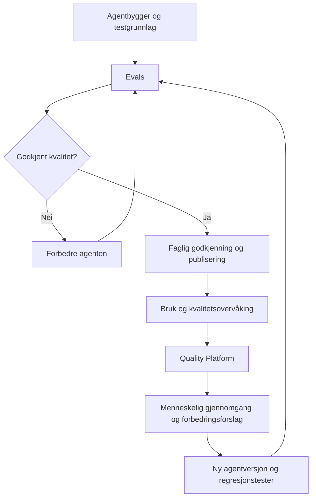

En KI-agent er en tjeneste som må kvalitetssikres og forvaltes gjennom hele levetiden. En god demonstrasjon er ikke tilstrekkelig: agenten må fungere på representative oppgaver, håndtere vanskelige situasjoner og fortsette å levere når modeller, kunnskapskilder og integrasjoner endres.

HVL etablerer to komplementære funksjoner: **Evals**, som gjennomfører og dokumenterer evalueringer, og **Quality Platform**, som følger opp kvaliteten over tid og organiserer forbedringsarbeidet.

## Obligatorisk kvalitetssikring

Alle offisielle HVL-agenter skal gjennom obligatoriske evalueringer før publisering. Agentbyggeren analyserer agentens formål, instruksjoner, modeller, kunnskapskilder, skills og verktøy. Et felles bibliotek med standardtester suppleres med agentspesifikke tester som KI kan foreslå. Fagansvarlige kvalitetssikrer testene og vurderingskriteriene.

| Hva evalueres? | Eksempel |
|---|---|
| Faglig kvalitet og kildebruk | Mime finner gjeldende regelverk og henviser til riktig kilde. |
| Pedagogikk | En Canvas-agent gir veiledning innenfor faglærerens rammer. |
| Sikkerhet og personvern | Agenten avviser forsøk på å hente informasjon brukeren ikke har tilgang til. |
| Verktøy og handlinger | Agenten bruker korrekt verktøy og ber om godkjenning når det kreves. |
| Samarbeid mellom agenter | Hele arbeidsflyten gir et korrekt resultat, også ved feil i en deloppgave. |
| Tilgjengelighet og språk | Tjenesten fungerer for brukergruppen og håndterer bokmål, nynorsk og relevant fagterminologi. |
| Ressursbruk | Kvalitet, responstid og kostnad vurderes samlet. |

Tester kan være automatiske, KI-støttede eller gjennomført av fagpersoner. KI-vurderinger er hjelpemidler, ikke en erstatning for faglig kontroll.

## Fra publisering til kontinuerlig forbedring

Quality Platform analyserer tillatte produksjonsspor, brukerfeedback og evalueringsresultater. Feil og avvik kan grupperes, prioriteres og omsettes til forslag om bedre instruksjoner, kilder, modellvalg, skills eller verktøy. Fagansvarlige kan gjennomgå utvalgte interaksjoner og episoder med nødvendig tilgang, og avgjøre hva som bør endres.

En feil som avdekkes i drift kan bli en ny regresjonstest, slik at samme feil ikke gjeninnføres i senere versjoner. Nye versjoner evalueres før de erstatter den publiserte agenten. Alvorlige feil kan medføre at en versjon trekkes tilbake eller at agenten midlertidig deaktiveres.

Dette er kontrollert forbedring, ikke at agenten på egen hånd endrer sine instrukser, rettigheter eller modellvekter. Mennesker har ansvar for kvalitet, prioritering og godkjenning.

## Kvalitetskontroll under faktisk bruk

Planen er at agentene får en dokumentert kvalitetsprofil fra evalueringene før publisering. Under drift kan en uavhengig kvalitetssikringsagent kontrollere en leveranse mot disse kriteriene og kravene til den aktuelle oppgaven. Ved mangler kan resultatet forbedres innenfor fastsatte grenser eller sendes til menneskelig vurdering. En slik kontroll er ikke en garanti for feilfri KI.

Kvalitetsavvik rapporteres tilbake til Quality Platform, slik at fagmiljøet kan analysere gjentakende problemer og lage nye tester. Ressursbruk vurderes også: unødvendige modellkall og ineffektive arbeidsprosesser skal kunne identifiseres. Kontrollomfanget tilpasses risiko og kompleksitet. Produksjonsagenten endres ikke ukontrollert; forbedringer går gjennom ny evaluering og godkjenning.

## Eksempel: Mime v2.0

En student spør om en frist. Mime gir et svar basert på en gammel rutine. Etter tilbakemelding undersøker tjenesteeier om feilen skyldes kilden, søket eller agentens instruksjoner. Riktig kilde og en ny test inngår i en forbedret versjon som evalueres før publisering. Dermed kan også andre tjenester som bruker samme kunnskapskilde få nytte av forbedringen.

Kvalitetsoppfølging må gjennomføres med innebygd personvern. Ikke alle samtaler skal lagres eller leses; utvalg, formål, tilgang, slettefrister og behandling av personopplysninger skal styres.

Se også [Sporbarhet og KI-forordningen](./sporbarhet.mdx).
