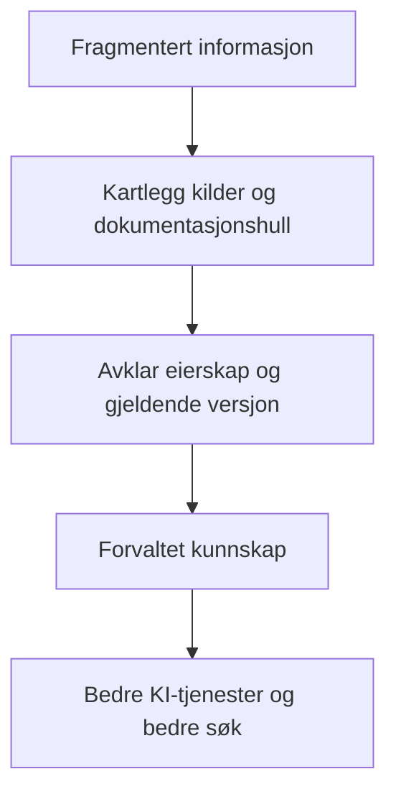

HVL har etter prosjektets situasjonsbeskrivelse ikke en enhetlig struktur for lagring, deling og forvaltning av rutinebeskrivelser og organisatorisk kunnskap. Informasjon kan ligge i personlige mapper, Teams, SharePoint, intranett eller fagsystemer. Flere versjoner, uklart eierskap og personavhengig kunnskap kan gjøre det vanskelig å finne det som faktisk gjelder.

Dette er et eksisterende informasjonsforvaltningsproblem som KI gjør mer synlig. Samtidig er KI-satsingen en mulighet til å få bedre kontroll.

Når en avdeling vil etablere en agent, kan den samtidig kartlegge dokumenter, rydde i motstridende rutiner, avklare ansvar og etablere vedlikeholdsprosesser. Kildeeiere avgjør hva som gjelder; KI kan hjelpe med å finne overlapp og mangler.

HVL Knowledge kan støtte kilderegister, metadata, aktualitetskontroll og godkjenning. SharePoint, arkiv og fagsystemer beholder sine roller.

**To parallelle gevinster:** bedre KI-tjenester og bedre organisatorisk informasjonsforvaltning. Sistnevnte har verdi også uten KI.

**Diskusjon:** Hvilke tre kunnskapskilder i din avdeling ville gitt størst nytte dersom de ble ryddet og forvaltet?
