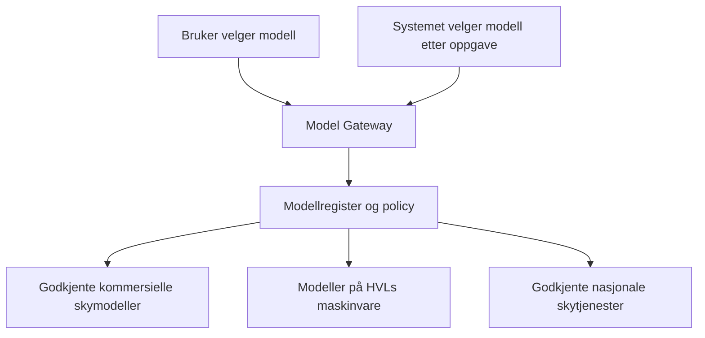

HVLs KI-økosystem består av spesialiserte komponenter som kan gjenbrukes på tvers av utdanning, forskning og administrasjon. I stedet for at hver KI-tjeneste etablerer egne integrasjoner, modelltilganger og kunnskapslag, benytter de en felles plattform.

## Komponentene i KI-økosystemet

| Komponent | Funksjonalitet og betydning |
|---|---|
| Frontend | Felles brukergrensesnitt for KI-chat, dokumenter, prosjekter og agenter. Brukerne kan velge tilgjengelige modeller, finne ferdige KI-tjenester og bygge egne agenter innenfor sine rettigheter. Andre HVL-applikasjoner kan også benytte plattformens tjenester. |
| Backend | Koordinerer plattformen, håndterer innlogging, brukeridentitet, rettigheter, samtaler og tjenestekall. Sørger for at brukernes kontekst og identitet forvaltes av HVL fremfor av modellleverandørene. |
| Model Gateway | Felles modellregister og tilgangspunkt for godkjente, tilgjengelige KI-modeller: kommersielle skymodeller, modeller på HVLs egen maskinvare og modeller via nasjonale skytjenester. Brukeren kan velge modell, eller systemet kan velge automatisk ut fra oppgave, kvalitet, språk, kostnad, kapasitet og datasikkerhet. Gateway håndhever modellpolicy og inkluderer PII-vaskemaskinen. |
| Agentbygger | Gjør det mulig å sette sammen KI-tjenester med formål, instrukser, modeller, kunnskapskilder, verktøy, arbeidsmetoder og tilgangsrammer. Fagmiljøene kan definere behov og teste løsninger før deling. |
| Agent Runtime | Gjennomfører agentenes arbeidsflyter, koordinerer modeller og verktøy, håndterer mellomresultater og stopper for menneskelig godkjenning når det kreves. |
| Memory Fabric | Forvalter relevant kontekst over tid, slik at brukere, prosjekter og agenter kan bygge videre på tidligere arbeid. Brukerminne, prosjektminne og agentminne har egne tilgangsrammer. Minne er ikke bundet til én modelltilbyder. |
| Toolserver | Tilbyr godkjente funksjoner som agenter og andre tjenester kan benytte, for eksempel å hente prosjektstatus eller utføre en kontrollert handling. Tilgang og godkjenning håndheves av HVL, ikke av språkmodellen. |
| Connectors | Kontrollerte integrasjoner mot eksisterende systemer som Canvas, SharePoint og GitHub. Gjør informasjon og funksjoner tilgjengelig for Knowledge og Toolserver innenfor gjeldende rettigheter. |
| Skills Library | Bibliotek med gjenbrukbare arbeidsmetoder, prosedyrer, maler og kvalitetskriterier. En fagavdeling kan utvikle en metode én gang og la flere agenter benytte den. |
| Agent Library | Katalog over ferdige KI-agenter for personlig, team- eller institusjonell bruk. Deling av en agent gir ikke automatisk tilgang til eierens data eller systemrettigheter. |
| HVL Knowledge | Felles kunnskapslag med tilgangsstyrt gjenfinning, kildehenvisninger og forvaltning av eksisterende informasjonskilder. Knowledge Library gir oversikt over gjenbrukbare kilder og samlinger. |

## Model Gateway: én inngang til mange modeller

Model Gateway skiller KI-tjenestene fra de enkelte modellleverandørene. Modellregisteret gir oversikt over godkjente modeller, hva de kan brukes til og hvilke rammer som gjelder for behandlingen. Det gir et felles grunnlag for både manuelle modellvalg og automatisk modellruting.

Automatisk modellvalg gjør det mulig å bruke en rimelig, rask modell til en enkel oppgave, en kraftigere modell til kompleks analyse og en modell i et godkjent internt miljø når data ikke kan sendes ut. Brukerens modellvalg må også respektere de samme sikkerhetsreglene.

Flere modeller kan samarbeide om én oppgave. En modell kan analysere data, mens en annen bearbeider resultatet til en god norsk respons. Nasjonalbibliotekets åpne [Borealis-modellserie](https://huggingface.co/NbAiLab) er en aktuell kandidat til en slik språk- og synteserolle på bokmål og nynorsk. Kvaliteten på faktainnhold og kildehenvisninger må bevares også når svaret omformuleres.

## Gevinsten ved en felles plattform

En avdeling kan utvikle en arbeidsmetode én gang og la flere agenter benytte den. Flere tjenester kan bruke samme kvalitetssikrede kunnskapskilde. Når nye modeller blir tilgjengelige og godkjent, kan de tilbys gjennom Model Gateway uten at hver enkelt KI-tjeneste må bygges om.

HVL beholder kontroll over brukerrelasjonen, konteksten, kunnskapen og integrasjonene. Modellene kan utvikles, byttes ut og kombineres over tid.
