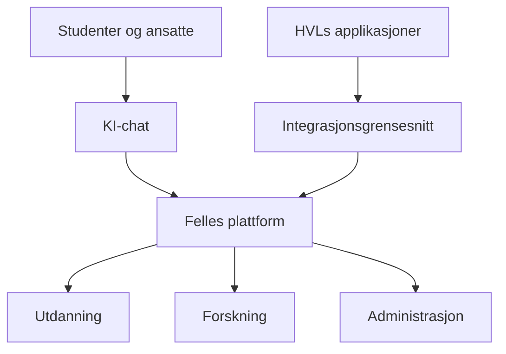

**Målgruppe:** ledere, fagmiljøer, administrative medarbeidere og andre interessenter. Ingen tekniske forkunnskaper nødvendig.

HVL tilbyr blant annet UiO-GPT og Microsoft Copilot. Brukerne etterspør mer avansert funksjonalitet som de kjenner fra Claude, ChatGPT og andre internasjonale tjenester. En enkel KI-chat dekker ikke alle disse behovene. Bruk av eksterne løsninger med interne data og systemintegrasjoner krever dessuten vurdering av personvern, informasjonssikkerhet og styring. Målet er et mer funksjonsrikt HVL-tilbud som kan erstatte UiO-GPT når den første versjonen er godkjent og driftsklar, uten å måtte kopiere alle kommersielle funksjoner.

Målet er en felles modulær plattform for KI i utdanning, forskning og administrasjon, ikke bare enda en chat. Vi vil kunne gjenbruke modeller, verktøy, kunnskapskilder og arbeidsmåter på tvers av tjenester.

Fra første lansering er målet to innganger: en moderne KI-chat for studenter og ansatte, og et integrasjonsgrensesnitt (API) slik at HVLs applikasjoner kan bruke KI og agenter direkte. Det åpner for emnetilpassede verktøy i Canvas, saksbehandlingsstøtte, Mime og KI-tjenester i forskningsmiljøet SILAF.

Arkitekturen er designet og betydelig utviklingsarbeid er gjennomført. Utviklingen skjer trinnvis, både mellom og innenfor modulene. Første versjon trenger ikke omfatte alle fremtidige tjenester. Se [veien til lansering](./pilot.mdx).

Innebygd personvern er et grunnprinsipp: HVL beholder brukeridentitet og personlig kontekst, og styrer hvilke opplysninger som eventuelt sendes til KI-modellene. Se [Innebygd personvern](./personvern.mdx).

Denne dokumentasjonen beskriver arkitektur og funksjonalitet for den planlagte utviklingen av HVLs KI-økosystem.
