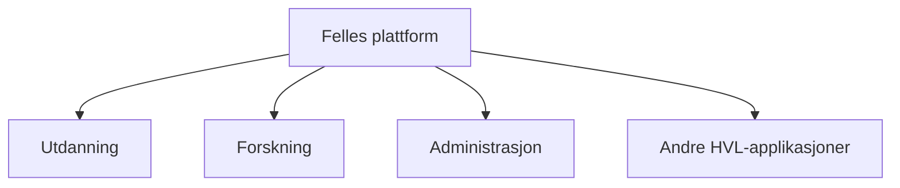

**Målgruppe:** ledere, fagmiljøer, administrative medarbeidere og andre interessenter. Ingen tekniske forkunnskaper nødvendig.

HVL har grunnleggende KI-chattilbud. Mer avanserte tjenester etterspørres, men bruk av eksterne løsninger med interne data og systemintegrasjoner krever vurdering av personvern, informasjonssikkerhet og styring.

Målet er en felles modulær plattform for KI i utdanning, forskning og administrasjon, ikke bare enda en chat. Vi vil kunne gjenbruke modeller, verktøy, kunnskapskilder og arbeidsmåter på tvers av tjenester.

Innebygd personvern er et grunnprinsipp: HVL beholder brukeridentitet og personlig kontekst, og styrer hvilke opplysninger som eventuelt sendes til KI-modellene. Se [Innebygd personvern](./personvern.mdx).

Dette er prosjektets målbilde. Det er ikke en påstand om at funksjonene allerede er i produksjon.
