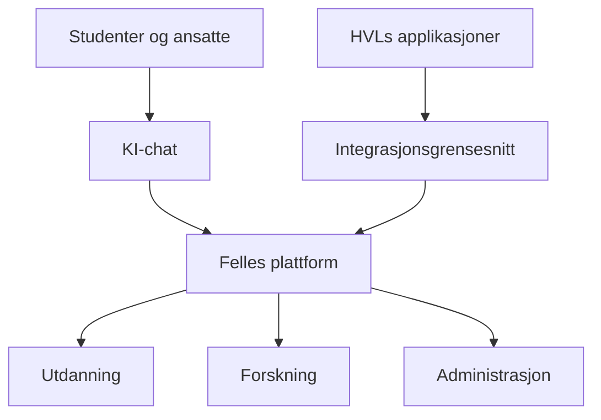

**Målgruppe:** ledere, fagmiljøer, administrative medarbeidere og andre interessenter. Ingen tekniske forkunnskaper nødvendig.

HVL tilbyr blant annet UiO-GPT og Microsoft Copilot. Brukerne etterspør mer avansert funksjonalitet som de kjenner fra Claude, ChatGPT og andre internasjonale tjenester. En enkel KI-chat dekker ikke alle disse behovene. Bruk av eksterne løsninger med interne data og systemintegrasjoner krever dessuten vurdering av personvern, informasjonssikkerhet og styring. Målet er et mer funksjonsrikt HVL-tilbud som kan erstatte UiO-GPT når den første versjonen er godkjent og driftsklar, uten å måtte kopiere alle kommersielle funksjoner.

Målet er en felles modulær plattform for KI i utdanning, forskning og administrasjon, ikke bare enda en chat. Vi vil kunne gjenbruke modeller, verktøy, kunnskapskilder og arbeidsmåter på tvers av tjenester.

Fra første lansering er målet to innganger: en moderne KI-chat for studenter og ansatte, og et integrasjonsgrensesnitt (API) slik at HVLs applikasjoner kan bruke KI og agenter direkte. Det åpner for emnetilpassede verktøy i Canvas, saksbehandlingsstøtte, Mime og KI-tjenester i forskningsmiljøet SILAF.

Første versjon skal tilby chat og enkle assistenter, god dokumentforståelse med kildebaserte svar, personlig hukommelse, modellvalg, bildegenerering og **nettsøk med kildehenvisninger**. Nettsøk er et lanseringskrav fordi det er viktig for brukernes daglige nytte. Et kontrollert API skal være på plass fra første versjon; publisering av egne agenter som API-er planlegges ved lansering eller i neste delleveranse.

## Hvorfor kan ikke alle KI-modeller tilbys umiddelbart?

Modelltilgjengelighet er ikke bare et teknologisk spørsmål. Nye modeller fra store internasjonale leverandører kan bli tilgjengelige i USA eller gjennom globale tjenester før de tilbys med avgrenset europeisk databehandling. Dette varierer mellom modeller, leverandører og tjenestetyper; det er ingen fast regel om hvor lenge man må vente. Brukerne ønsker gjerne tilgang til de nyeste og beste modellene, men den største modellen er ikke nødvendigvis best egnet til alle oppgaver.

Microsoft Foundry er et eksempel på en tjeneste der modellutvalg og behandlingsgeografi varierer mellom globale, europeiske og regionale utrullingsalternativer. En europeisk ressursadresse er ikke i seg selv en garanti for at all behandling skjer i Europa. Tilgang til en modell som krever behandling i USA eller andre tredjeland forutsetter at HVL har vurdert og godkjent tjenesten og det konkrete behandlingsformålet, med nødvendig overføringsgrunnlag der personopplysninger overføres. Behandling i EØS er heller ikke alene en garanti for GDPR-etterlevelse.

HVLs modellstrategi kombinerer godkjente kommersielle, nasjonale og lokalt kjørte modeller. Vi kan supplere modellutvalget etter hvert som nye modeller og behandlingsmiljøer godkjennes, og velge den best egnede modellen for oppgaven innenfor tillatte rammer. Enkle oppgaver kan løses effektivt med mindre modeller; krevende analyse kan ha nytte av kraftigere modeller. Kvalitet, språk, personvern, responstid, kapasitet og kostnad må inngå i vurderingen. Brukerens modellpreferanse kan aldri overstyre sikkerhetskravene.

Kilder: [Microsoft Foundry – modelltilgjengelighet per region](https://learn.microsoft.com/en-us/azure/foundry/foundry-models/concepts/models-sold-directly-by-azure-region-availability), [utrullingstyper og behandlingsgeografi](https://learn.microsoft.com/azure/ai-foundry/foundry-models/concepts/deployment-types) og [Datatilsynet – overføring av personopplysninger ut av EØS](https://www.datatilsynet.no/regelverk-og-verktoy/sporsmal-svar/overforing-av-personopplysninger-ut-av-eos/).

## Eksempler på modeller HVL kan tilby

HVLs KI-økosystem er ikke bundet til én modellleverandør. Følgende er eksempler på aktuelle modellfamilier og mulige driftsformer, ikke en liste over allerede godkjente eller tilgjengelige modeller ved HVL.

| Driftsform | Eksempel på modellfamilie | Aktuell bruk |
|---|---|---|
| Microsoft Foundry | OpenAI GPT, inkludert mindre modellvarianter | Generell KI-assistanse, analyse, programmering og agentoppgaver. |
| Microsoft Foundry | Anthropic Claude (Haiku, Sonnet og Opus) | Dokumentarbeid, analyse, programmering og sammensatte oppgaver. |
| Microsoft Foundry | Mistral, eksempelvis Mistral Large | Flerspråklig tekstbehandling, analyse og agenter. |
| Lokal drift ved HVL | OpenAI gpt-oss, eksempelvis 20B og 120B | Resonnering og agentoppgaver uten å sende selve modellforespørselen til en ekstern modellleverandør. |
| Lokal drift ved HVL | Utvalgte modeller fra Mistral, eksempelvis Mistral Small | Flerspråklige oppgaver, dokumentarbeid og lokale assistenter. |
| Lokal drift ved HVL | Nasjonalbibliotekets NB-Whisper | Norsk tale-til-tekst og transkripsjon. |
| Lokal drift ved HVL | Chatterbox | Tekst-til-tale og lydproduksjon. |
| Andre godkjente leverandører og nasjonale tjenester | Modeller som tilbys gjennom egnede avtaler og behandlingsmiljøer | Utvidelse av modellutvalget og kapasiteten etter behov. |

Det er ikke nødvendig å kjøpe separate sluttbrukerlisenser til ChatGPT, Claude og andre produkter for å benytte de underliggende modellene gjennom godkjente API-er. Modelltilgang via API er imidlertid ikke det samme som tilgang til alle funksjonene i leverandørens ferdige produkt. HVL utvikler sitt eget tjenestelag for blant annet nettsøk, agenter, dokumentarbeid og integrasjoner.

For Foundry må tilgjengelighet, konkret behandlingsregion, leverandørrolle og vilkår avklares per modell og utrulling. Claude i Foundry kan ha andre avtale- og behandlingsvilkår enn modeller som leveres direkte av Microsoft. For lokal drift må modellstørrelse, lisens, kvalitet, maskinvarekapasitet og samtidighet vurderes; eksemplene innebærer ikke at alle modellene kan betjene produksjonslast på dagens GB10-maskiner. Lokale modeller er særlig relevante der eksterne modellkall ikke er tillatt, men dataklassene må godkjennes for den konkrete installasjonen.

Brukerne skal kunne velge mellom modellene som er godkjent for deres oppgave og arbeidsmiljø. Plattformen kan også velge en egnet modell automatisk. Utvalget kan endres uten å bygge om hele KI-tjenesten.

**Kilder:** [Microsoft Foundry – Azure-modeller og regioner](https://learn.microsoft.com/en-us/azure/foundry/foundry-models/concepts/models-sold-directly-by-azure-region-availability), [modellkatalog for partnermodeller](https://learn.microsoft.com/azure/ai-foundry/foundry-models/concepts/models-from-partners), [Claude og driftsalternativer i Foundry](https://learn.microsoft.com/en-us/azure/foundry/foundry-models/concepts/claude-models-hosting-comparison), [OpenAI gpt-oss](https://openai.com/open-models/), [Mistrals modelloversikt](https://docs.mistral.ai/models), [NB-Whisper](https://huggingface.co/NbAiLab/nb-whisper-small) og [Chatterbox](https://github.com/resemble-ai/chatterbox). Modellkataloger endres fortløpende.

Tale-til-tekst og stemmesamtaler på norsk og engelsk prioriteres tidlig, blant annet for tilgjengelighet. Podcastgenerering vurderes senere, og videogenerering har svært lav prioritet.

Arkitekturen er designet og betydelig utviklingsarbeid er gjennomført. Utviklingen skjer trinnvis, både mellom og innenfor modulene. Første versjon trenger ikke omfatte alle fremtidige tjenester. Se [veien til lansering](./pilot.mdx).

**Vi bygger videre på eksisterende åpen kildekode.** LangGraph er allerede tatt i bruk i utviklingsarbeidet for å organisere KI-agentenes arbeidsflyt. Sikkerhet, lisensvilkår, vedlikehold og egnethet for HVLs infrastruktur vurderes før nye komponenter innføres. Dette frigjør kapasitet til HVLs egne behov og integrasjoner.

HVL vil søke utviklingssamarbeid i sektoren, først med UiB. Strategisk prioritering, dedikerte utviklerressurser og bidrag fra hele ITT er nødvendig for å komme videre. Se [beslutningsgrunnlaget](../prodekanforum/intro.mdx).

Innebygd personvern er et grunnprinsipp: HVL beholder brukeridentitet og personlig kontekst, og styrer hvilke opplysninger som eventuelt sendes til KI-modellene. Se [Innebygd personvern](./personvern.mdx).

Denne dokumentasjonen beskriver arkitektur og funksjonalitet for den planlagte utviklingen av HVLs KI-økosystem.
