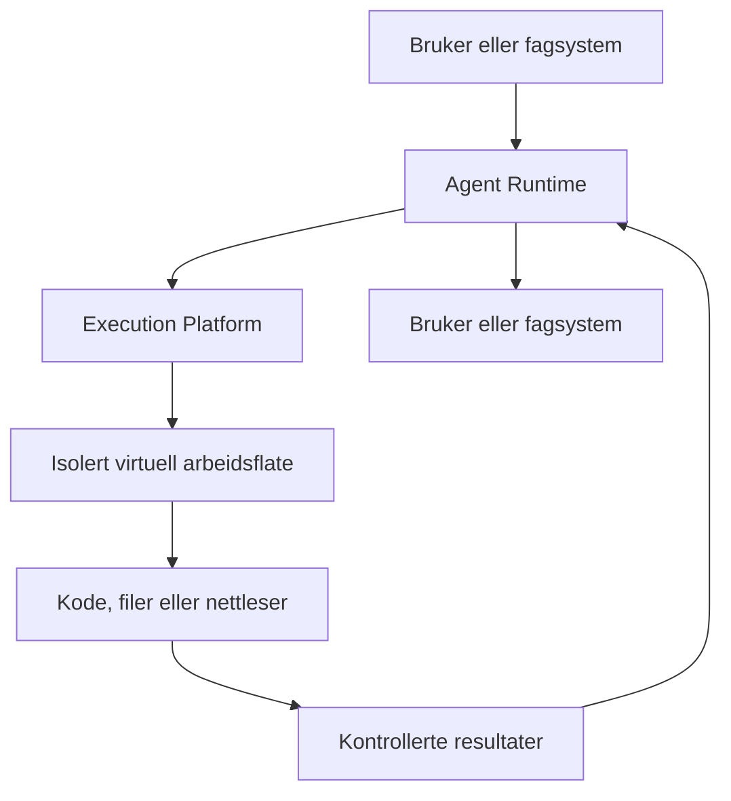

En språkmodell kan skrive kode eller foreslå en handling. For å gjennomføre praktiske oppgaver trenger en agent også et sted å arbeide. HVL KI-økosystemet gir agenter tilgang til isolerte virtuelle kjøremiljøer gjennom en felles Execution Platform.

Agent Runtime koordinerer oppgaven. Det virtuelle miljøet utfører konkret arbeid, som å kjøre et program, bearbeide filer eller bruke en nettleser. En enkel chat trenger ikke et eget virtuelt miljø.

## Hva kan agenten gjøre?

| Funksjon | Eksempel |
|---|---|
| Kodekjøring | Analysere en tabell, beregne statistikk og kontrollere resultatene. |
| Dokumentproduksjon | Lage en rapport, et regneark eller en presentasjon og kontrollere at filen fungerer. |
| Computer Use | Bruke nettleser eller annet grafisk program innenfor godkjente rammer. |
| Langvarige arbeidsoppgaver | Arbeide med flere dokumenter, prøve en metode, kontrollere resultatet og forbedre det. |

## Et avgrenset miljø, ikke en fri tilgang til HVL

Agenten får en midlertidig arbeidsflate med egne filer og begrensede ressurser. Den får ikke automatisk tilgang til andre brukeres arbeidsområder, HVLs interne nettverk eller brukerens innloggingsopplysninger. Fagsystemtilgang går via godkjente integrasjoner og kontrollerte verktøy; nettlesertilgang og andre utgående forbindelser begrenses av policy.

Et arbeidsmiljø kan bevares under en oppgave slik at agenten kan bygge videre på egne mellomresultater. Når arbeidet er ferdig, eksporteres tillatte resultater og miljøet ryddes eller avvikles. Ressursgrenser, tidsgrenser og mulighet for å stoppe arbeidet gjelder hele kjøringen.

## Bruk i praksis

En forsker kan få hjelp til å analysere et tillatt datasett og produsere kode og figurer. En administrativ medarbeider kan få en rapport basert på godkjente dokumenter. Agenten kan kontrollere sine egne leveranser ved å åpne filene eller kjøre beregningene på nytt. For forskningsdata og andre beskyttede data må miljøet være godkjent for formålet.

Dette utvider plattformen fra å gi tekstsvar til å utføre arbeid og levere faktiske resultater. Samtidig kan HVL styre hvilke handlinger som er tillatt og hvilke som krever menneskelig godkjenning.

Se også [Sporbarhet og KI-forordningen](./sporbarhet.mdx).
