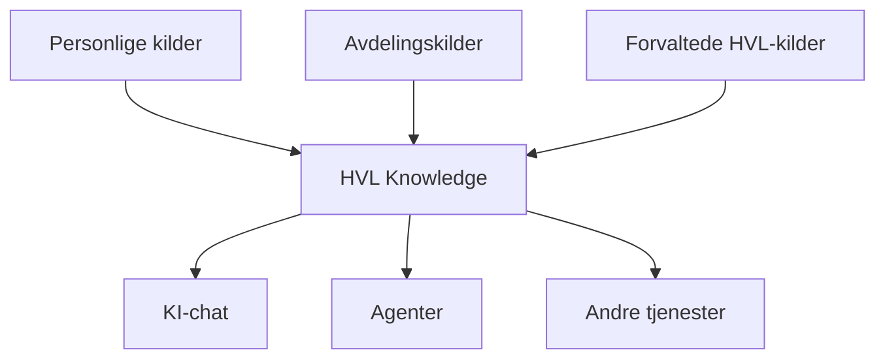

KI trenger tilgang til riktig, oppdatert informasjon. HVL Knowledge skal gjøre informasjon tilgjengelig fra eksisterende systemer, ikke nødvendigvis flytte den.

Personlige connectors kan koble til OneDrive. Avdelingsvise connectors kan koble til SharePoint. Prosjekter og emner kan ha egne kilder. På sikt skal HVL Knowledge tilby forvaltede institusjonelle kilder, som regelverk, HR-rutiner, IT-veiledninger og kvalitetssystem.

Kildeeierne skal vedlikeholde originalinformasjonen. Knowledge Library kan gjøre kilder tilgjengelige for gjenbruk. Når en rutine oppdateres, skal agentene kunne bruke den oppdaterte kilden gjennom oppslag eller synkronisering. Brukerne får ikke automatisk tilgang til dokumenter bare fordi de bruker en agent.
