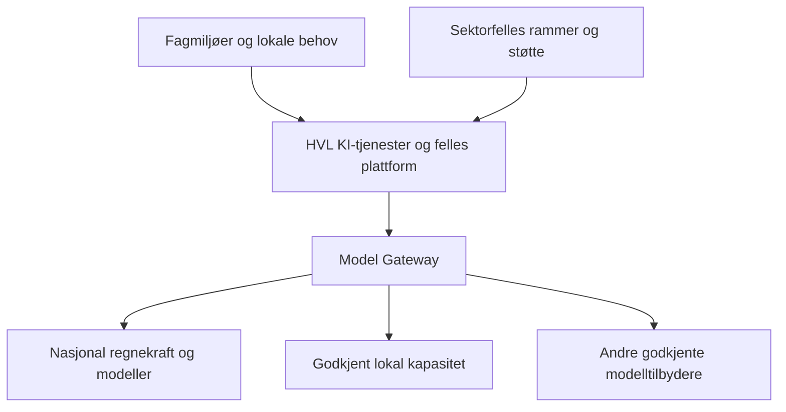

Malthe-Sørenssen-utvalget la 6. november 2026 frem [NOU 2026: 14 – Kunstig intelligens i høyere utdanning: I kunnskapens tjeneste](https://www.regjeringen.no/no/dokumenter/nou-2026-14/id3191187/). Kapittel 4 drøfter grunnleggende problemstillinger og juridiske rammer. Kapittel 8 handler om forvaltning av KI-systemer og gir anbefalinger til institusjonene og sentrale myndigheter.

Denne gjennomgangen kobler utredningen til HVLs arkitektur. Første kolonne i tabellene viser til temaer i NOU-en; de øvrige kolonnene er prosjektets vurdering av hvordan arkitekturen kan brukes, og hva som må ivaretas organisatorisk.

## Kapittel 4 – kontroll, rettigheter og digital suverenitet

[Les kapittel 4 i NOU-en](https://www.regjeringen.no/no/dokumenter/nou-2026-14/id3191187/?ch=3).

| Tema i NOU-en | Hvordan HVL KI-økosystem møter problemstillingen | Videre arbeid |
|---|---|---|
| 4.2.1–4.2.3: Etterprøvbarhet, samsvar, riktighet og likebehandling | Knowledge gir kildebaserte svar. Agent Runtime, versjonerte agentdefinisjoner, skills og Toolserver gir kontrollpunkter i arbeidsflyten. | Test faktisk svarkvalitet, skjevheter og sporbarhet. Kilder og logger er ikke i seg selv bevis for riktige svar. |
| 4.2.4 og 4.3.3: Personopplysninger | Identitet og minne holdes under HVLs kontroll. Model Gateway minimerer og vasker konteksten før modellkall, og velger tillatt behandlingsmiljø. | Behandlingsgrunnlag, slettefrister, leverandørvilkår og vurdering av personvernkonsekvenser der det er påkrevd. |
| 4.2.4 og 4.3.6: Opphavsrett | Knowledge henter relevante utdrag fra kilder som er tilgjengelige for brukeren, fremfor å gjøre trening av egne modeller til en forutsetning. | Avklar lisenser og rett til indeksering, modellbehandling og viderebruk; tilgang til en kilde er ikke alltid tilstrekkelig. |
| 4.2.5: Bærekraft | Gateway kan velge en mindre ressurskrevende modell når den er egnet. Felles komponenter kan redusere dobbeltarbeid. | Mål faktisk ressursbruk og kvalitet, inkludert lokal maskinvare, energi og skytjenester. |
| 4.2.6–4.2.8: Menneskelige og samfunnsmessige konsekvenser | Fagmiljøene kan utforme læringsstøtte med pedagogiske rammer, og velge flere modeller og kunnskapskilder. | Undersøk læringseffekt, inkludering, selvstendighet og akademisk frihet. Unngå at personalisering blir overvåkning. |
| 4.2.9: Digital suverenitet | Modellregister, eget kontekstlag og standardiserte integrasjoner skiller HVLs tjenester fra modelltilbyderne. | Sikre reell portabilitet, alternative leverandører og dokumenterte utfasingstiltak. |
| 4.3.1–4.3.5: Rettslige rammer | Tilgangsstyring, policy, avgrensede verktøy, menneskelig godkjenning og revisjonsspor er felles byggesteiner. | Vurder hvert system ut fra formål og risiko, herunder KI-forordningen, forvaltningsrett, menneskerettigheter og diskrimineringsvern. |

HVLs viktigste arkitekturvalg i denne sammenhengen er å eie brukerrelasjonen og tjenestelaget, fremfor å bygge hele arbeidsprosessen rundt én modellleverandør. Pseudonymisering reduserer eksponeringen av identitet, men innebærer ikke nødvendigvis anonymisering. Personvern og sikkerhet må gjelde alle modellkall, også hjelpekall og embeddings.

## Kapittel 8 – forvaltning av KI-systemer

[Les kapittel 8 i NOU-en](https://www.regjeringen.no/no/dokumenter/nou-2026-14/id3191187/?ch=4).

| Tema i NOU-en | Kobling til HVLs arkitektur | Videre arbeid |
|---|---|---|
| 8.4: Utdanningsfaglige og fagspesifikke behov | Agentbygger, skills og Knowledge gjør det mulig å utvikle pedagogiske verktøy og andre fagtilpassede applikasjoner, ikke bare generell chat. | Involver undervisere og studenter; evaluer læringsutbytte og faglig egnethet. |
| 8.4 og 8.5.10: Helhetlig og sikker infrastruktur | Felles API-er, Model Gateway og gjenbrukbare plattformtjenester gir en sammenhengende arkitektur. | Kapasitetsplanlegging, sikkerhetskrav, interoperabilitet og tilgjengelighet. |
| 8.5: Digital suverenitet, språk og akademiske verdier | Modellvalg på tvers av behandlingsmiljøer, norsk syntesemodell som Borealis, fagterminologi via Knowledge og lokale faglige rammer. | Evaluer bokmål, nynorsk og fagterminologi; sikre åpne alternativer, universell utforming og faglig autonomi. |
| 8.5: Likeverdig tilgang og ressursbruk | Institusjonell tilgang og felles modellregister kan gjøre relevante verktøy tilgjengelige uten individuelle abonnementer. | Finansiering, brukskvoter, tilgjengelighet, opplæring og måling av totalkostnad. |
| 8.6.1–8.6.2: Samarbeid og utvikling | Modulære tjenester og API-er kan kobles til nasjonale modell- og infrastrukturtjenester og deles med andre UH-institusjoner. | Avklar samarbeid, åpne standarder, ansvar og lisensiering. |
| 8.6.3–8.6.4: Felles rammeverk og støttefunksjoner | Gateway, policy og kataloger gir tekniske steder å håndheve felles krav. | Delta i sektorens arbeid med juridiske, tekniske og sikkerhetsfaglige støttefunksjoner; etablere lokalt eierskap. |
| 8.6.5 og 8.7: Lokalt ansvar og sentrale tiltak | HVL kan utvikle egne tjenester innenfor felles sektorrammer og bruke nasjonal regnekraft når den er egnet og godkjent. | Institusjonelt ansvar, styring, finansiering og sektoravtaler må avklares. |

## Nasjonal infrastruktur og lokal innovasjon

Et viktig skille i kapittel 8.6.2 er mellom infrastrukturen for regnekraft og datalagring og utviklingen av applikasjoner som bruker den. Utvalget fraråder at hver institusjon bygger opp en separat, fullstendig datainfrastruktur, og peker på statlig og internasjonalt samarbeid. Samtidig fremheves handlingsrom for lokal utvikling og tilgang til modeller gjennom API-er.

HVLs KI-økosystem kan derfor være et lokalt tjeneste- og integrasjonslag på toppen av flere infrastrukturer. Egen maskinvare kan dekke konkrete, dokumenterte behov der det er nødvendig, mens nasjonale eller andre godkjente tjenester kan dekke øvrige behov. Omfanget av lokale investeringer må vurderes opp mot fellestilbud, risiko, kostnader og kapasitet.

Samarbeid om plattformkomponenter med andre institusjoner kan gi felles utvikling, samtidig som hver institusjon beholder egne integrasjoner, tilgangsregler og faglige tjenester. Dette er en mulig praktisk realisering av samspillet utvalget beskriver, ikke en anbefaling fra utvalget om akkurat HVLs løsning.

## Samlet vurdering

Det er en tydelig sammenheng mellom flere av utvalgets temaer og HVLs planlagte arkitektur: leverandøruavhengighet, innebygd personvern, faglig tilpasning, norsk fagspråk, gjenbruk og sektorielt samarbeid. Plattformen gir tekniske kontrollmuligheter, mens ledelse, fagmiljøer og støttefunksjoner må forvalte dem. Utredningen gir ikke i seg selv godkjenning av en bestemt arkitektur, og teknisk samsvar må suppleres med dokumentert kvalitet, rettslige vurderinger og forvaltning.

Se også [Innebygd personvern](./personvern.mdx) og [En felles grunnmur](./gjenbruk.mdx).
