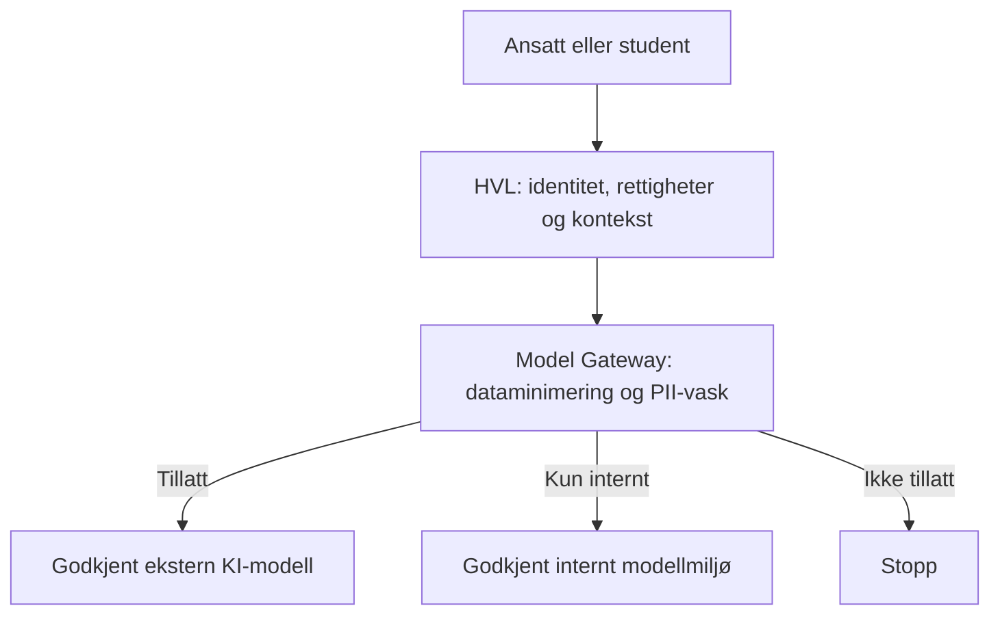

Personvern skal være en del av hvordan HVLs KI-økosystem bygges fra starten. HVL skal håndtere brukeridentitet, innlogging, tilgangsstyring, samtalehistorikk og personlig kontekst. Eksterne KI-modeller skal ikke trenge å vite hvem brukeren er.

**HVL eier brukerrelasjonen og konteksten. KI-modellene er utskiftbare beregningsressurser.**

## Hva betyr det i praksis?

- Brukerne autentiseres ved HVL, eksempelvis gjennom FEIDE eller Entra ID. Identiteten holdes internt og brukerne pseudonymiseres der det er relevant.
- Eksterne KI-tjenester skal ikke motta brukerens navn, e-postadresse eller innloggingsidentitet som brukermetadata.
- Bare opplysninger som er nødvendige og godkjent for oppgaven, skal sendes til modellen. Selve prompten og konteksten kan likevel inneholde personopplysninger.
- Model Gateway skal ha en PII-vaskemaskin som kan oppdage, maskere eller pseudonymisere personopplysninger i det som eventuelt sendes ut.
- Klassifisering og godkjente behandlingsmiljøer styrer modellvalget. Hvis ekstern behandling ikke er tillatt, må oppgaven behandles i et egnet, godkjent internt miljø eller stoppes.
- Eksterne modeller får ikke direkte tilgang til HVLs interne systemer eller brukerens minne. HVLs tjenester kontrollerer oppslag og handlinger.

## Hvorfor er dette viktig?

HVL kan bytte og kombinere modeller uten å overlate brukerrelasjonen eller den samlede personlige konteksten til hver enkelt leverandør. Det gjør det lettere å etablere felles sikkerhetsregler, begrense utlevering og kontrollere hvordan KI benyttes på tvers av institusjonen.

Eksempel: En ansatt ber om hjelp til å oppsummere et dokument. Systemet vurderer hvilke opplysninger modellen faktisk trenger, om identifiserende opplysninger kan fjernes, og om behandlingen er tillatt hos valgt leverandør.

Pseudonymisering er ikke det samme som anonymisering. En PII-vaskemaskin kan heller ikke garantere at alle personopplysninger blir oppdaget. Personvern krever derfor flere tiltak i kombinasjon, blant annet dataminimering, tilgangskontroll, sletterutiner, risikovurdering og leverandøravtaler.

Dette er et foreslått arkitekturprinsipp i tråd med tankegangen bak GDPR artikkel 25 om innebygd personvern og personvern som standardinnstilling. Det er ikke en påstand om at løsningene er ferdig implementert eller godkjent for alle typer data.
