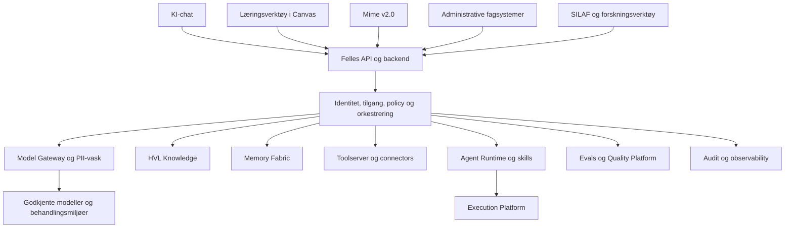

HVLs KI-økosystem er ikke begrenset til en KI-chat. Det er en felles teknologisk grunnmur for utvikling av nye KI-tjenester og for å legge KI-funksjonalitet inn i eksisterende systemer. Brukeren trenger ikke åpne et eget chatgrensesnitt for å dra nytte av KI.

## Én plattform – mange brukerflater

En applikasjon kan benytte plattformens tjenester gjennom kontrollerte API-er. Den trenger ikke selv å etablere modelltilgang, PII-vask, minneløsninger, kildeoppslag eller agentkjøring. Samtidig bestemmer den enkelte tjenesten sitt formål, grensesnitt, kontekst og arbeidsprosess.

## 1. Personlig læringsstøtte i Canvas

En læringsassistent kan integreres i Canvas, eksempelvis via LTI, og tilpasses hvert emne. Faglærer setter pedagogiske rammer og velger læringsutbytter, pensum, emneinnhold, oppgavebeskrivelser og vurderingskriterier.

Studenten får forklaringer, hint, øvingsoppgaver og formative tilbakemeldinger, tilpasset emnet og egen progresjon. Assistenten skal støtte studentens arbeid, ikke gjøre det for studenten. Det skal være mulig å variere veiledningsmetoden mellom emner.

En personlig læringsstøtte kan følge studenten over flere emner dersom dette er formålstjenlig og tillatt. Memory Fabric holder personlig kontekst adskilt fra emnets felles kunnskap. Faglærer kan også etablere læringsaktiviteter for grupper, der KI støtter samarbeid og dialog i stedet for å erstatte kontakt med medstudenter og undervisere.

Faglæreren skal kunne styre rammene uten å få automatisk innsyn i studentenes private samtaler eller minne. Læringsanalyse og deling må ha egne formål, tilgangsregler og nødvendige vurderinger.

## 2. Mime v2.0 – student- og ansattservice

[Mime](https://www.hvl.no/om/kontaktinformasjon/chat/) er HVLs virtuelle assistent for blant annet IT-spørsmål, opptak og studenthverdagen. En videreutviklet Mime kan bruke KI-økosystemets tjenester fremfor å etablere et eget isolert kunnskapslag.

HVL Knowledge gir tilgang til gjeldende rutiner, nettsider og veiledninger med kildehenvisninger. En offentlig Mime kan svare med offentlige kilder uten innlogging. Ved autentisering kan en egen tjeneste tilby mer målrettet hjelp basert på brukerens tillatte kontekst og rettigheter.

Eksempel: En student ønsker informasjon om tilrettelegging ved eksamen. Mime finner gjeldende veiledning og frister, forklarer prosessen og peker til riktig skjema. En eventuell oppfølging av egen søknad skjer gjennom en godkjent connector og med autentisering, ikke gjennom direkte modelltilgang til saksbehandlingssystemet.

Mime skal kunne henvise videre til en medarbeider når den ikke finner et pålitelig svar, eller saken krever individuell vurdering.

## 3. KI i administrative saksbehandlingssystemer

KI kan inngå i den eksisterende arbeidsflaten til en saksbehandler: eksempelvis i søknadsbehandling, HR, innkjøp eller brukerstøtte. KI-funksjonaliteten trenger ikke fremstå som chat; den kan være en knapp for å oppsummere dokumenter, kontrollere fullstendighet eller finne relevant regelverk.

Et eksempel er behandling av søknader om tilrettelegging. En tjeneste kan strukturere innhold, vise manglende dokumentasjon, finne aktuelle bestemmelser og utarbeide et utkast til saksnotat. Dokumenter og sensitive opplysninger behandles kun i godkjent miljø. PII-vask gir ikke i seg selv tillatelse til ekstern behandling.

Saksbehandler vurderer grunnlaget, korrigerer utkastet og tar beslutningen. Fagsystemet og arkivet beholder autoritativ informasjon og dokumentasjon. KI-støtten må ivareta saksbehandlingsregler, taushetsplikt, sporbarhet, likebehandling og relevante krav til risikoklassifisering.

## 4. KI-tjenester i SILAF

Forskere og masterstudenter benytter HVLs forskningsservermiljø SILAF via fjernskrivebord med tofaktorautentisering. Målbildet er å tilgjengeliggjøre HVLs KI-chat og andre KI-funksjoner i dette miljøet, for eksempel via et kontrollert API, et notebook-miljø eller et tilpasset analyseverktøy. En strengere sikkerhetsprofil må kunne begrense modellvalg, verktøy, nettsøk, ekstern kommunikasjon, agenthandlinger og deling av samtaler og artefakter etter prosjektets behov. En separat instans av nødvendige komponenter kan vurderes dersom datagrensene krever det. Tilgang til SILAF er ikke i seg selv godkjenning for KI-behandling.

Mulige tjenester er transkripsjon, strukturering og koding av intervjumateriale, dokumentanalyse, søk i forskningsmateriale og programmeringsstøtte. Forskningsprosjektet velger kilder, analysemetoder, godkjent modell og behandlingsmiljø i tråd med prosjektets rammer.

Forskningsdata skal ikke automatisk kopieres til den generelle KI-plattformen. For materiale som må forbli i et avgrenset forskningsmiljø, må behandlingen skje der eller via særskilt godkjent infrastruktur. Model Gateway kan tilby et godkjent lokalt modellendepunkt, eller tjenesten kan kjøres isolert nær dataene med samme arkitekturprinsipper. Prosjektminne, mellomresultater, logger og modellkontekst følger prosjektets tilgangs- og lagringsregler.

Modellversjon, metode og relevante parametere kan dokumenteres for å støtte etterprøvbarhet. Forskeren har fortsatt ansvar for metodikk, kontroll av resultater og forskningsetikk.

## Felles komponenter, ulike formål

| Tjeneste | Særlig nytte av felles grunnmur | Tjenestespesifikt ansvar |
|---|---|---|
| Canvas | Knowledge, skills, Memory Fabric, Gateway, emneintegrasjon | Pedagogikk, emnerammer, læringskvalitet |
| Mime v2.0 | Knowledge, Gateway, connectors, Runtime | Servicekvalitet, kilder, eskalering |
| Saksbehandling | Knowledge, Gateway, Toolserver, policy, revisjonsspor | Saksansvar, rettslige vurderinger, arkiv |
| SILAF | Godkjent modelltilgang, skills, avgrenset kontekst | Forskningsdata, metode, prosjektgodkjenning |

## Hvorfor bygge felles?

Nye tjenester kan utvikles uten at hvert prosjekt gjentar arbeidet med modellintegrasjoner, identitet, sikkerhet og kildeoppslag. Forbedringer av plattformen kan komme flere tjenester til gode. En ny modell kan gjøres tilgjengelig i Gateway uten å endre alle brukerflater, så lenge modellens egnethet og godkjenninger er ivaretatt.

Felles grunnmur betyr ikke at alle data, agenter eller brukere får felles tilgang. Hver tjeneste har egne formål, tillatelser, datagrenser og ansvar. Plattformen må håndheve disse også når den brukes fra andre systemer enn KI-chatten.

Eksemplene viser ulike muligheter for utvikling ved HVL. Fagmiljøer, tjenesteeiere og forskningsmiljøer må involveres i prioritering, utforming og evaluering. Felles plattformutvikling gjør at innsatsen i større grad kan rettes mot faglig verdi og arbeidsprosesser fremfor gjentatt utvikling av grunnleggende KI-infrastruktur.

Alle offisielle tjenester med agenter bruker plattformens felles kvalitetssikring, kontrollert utførelse og sporbarhet. Se [evaluering](./evaluering.mdx), [virtuelle arbeidsmiljøer](./kjoremiljo.mdx) og [sporbarhet](./sporbarhet.mdx).
