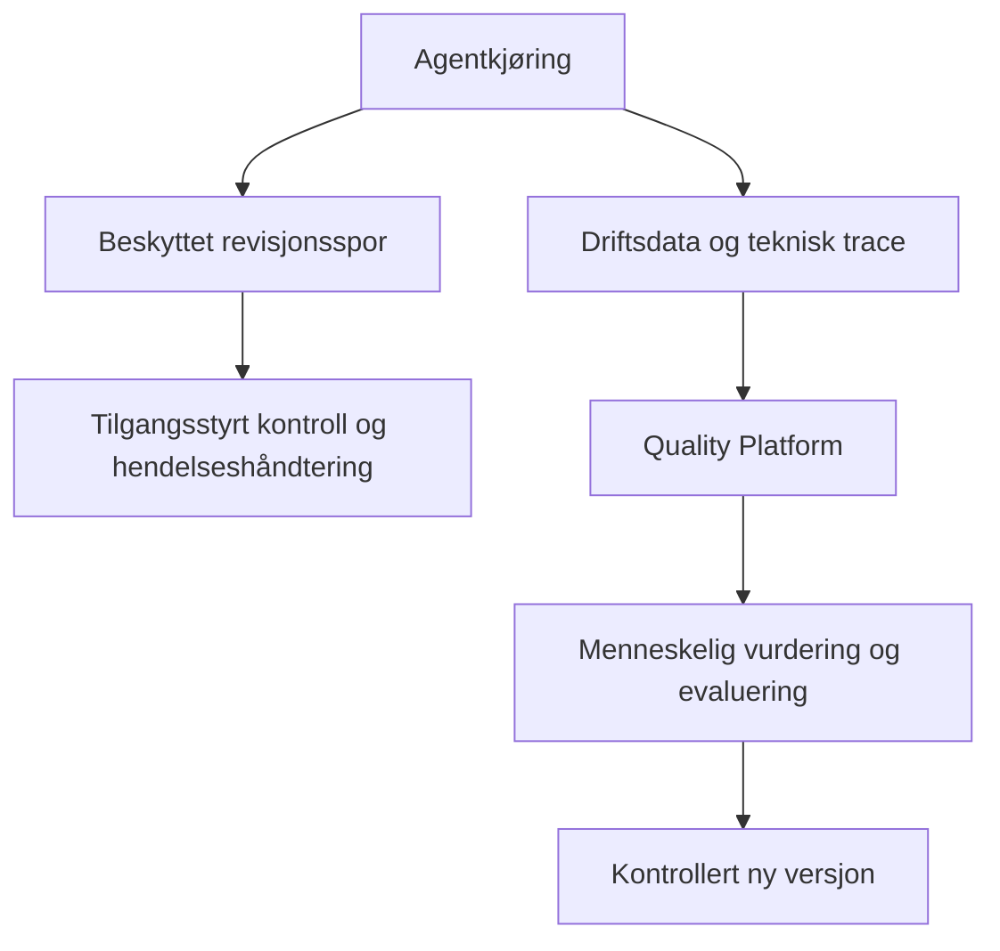

Når en KI-tjeneste henter informasjon, bruker flere modeller eller utfører handlinger, må HVL kunne undersøke hva som skjedde, hvilken versjon som ble brukt og hvilke kontroller som ble gjennomført. Dette er nødvendig for hendelseshåndtering, kvalitetsforbedring og ansvarlig forvaltning.

## Tre ulike formål

| Funksjon | Hva den gir HVL |
|---|---|
| Driftslogger og overvåking | Oversikt over feil, tilgjengelighet, kapasitet og responstid. |
| Tracing | Sammenheng mellom stegene i en agentkjøring, modellvalg, kildeoppslag og verktøykall. |
| Audit / revisjonsspor | Dokumentasjon av relevante tilgangskontroller, handlinger, policybeslutninger, godkjenninger og publiserte versjoner. |

Disse funksjonene henger sammen gjennom en felles kjøringsidentifikator. HVL kan for eksempel undersøke om et feilaktig svar skyldes en utdatert kunnskapskilde, feil modellvalg eller en feil i agentens arbeidsflyt. En sporbar hendelse er ikke det samme som å kjenne modellens interne tankeprosess.

## Sammenheng med EU AI Act

[EUs KI-forordning, forordning (EU) 2024/1689](https://eur-lex.europa.eu/eli/reg/2024/1689) stiller ulike krav avhengig av KI-systemets formål, risikoklasse og virksomhetens rolle som tilbyder eller idriftsetter.

For høyrisikosystemer er særlig artikkel 9–15 om risikostyring, dokumentasjon, logging, transparens, menneskelig kontroll og robusthet relevante. Artikkel 12 krever automatisert hendelsesregistrering gjennom systemets levetid. Artikkel 19 og 26 nr. 6 omhandler oppbevaring av slike logger under henholdsvis tilbyderens og idriftsetterens kontroll. Artikkel 72 omhandler tilbyderens oppfølging etter at høyrisikosystemet er tatt i bruk.

HVLs felles audit-, evaluerings- og kvalitetsfunksjoner gir tekniske byggesteiner for å understøtte disse kravene. Kravene må vurderes for hver tjeneste, inkludert gjeldende norsk/EØS-rett. En generell KI-chat er ikke automatisk et høyrisikosystem. En tjeneste som brukes til opptak eller evaluering av læringsresultater kan derimot falle innenfor høyrisikokategoriene i vedlegg III, avhengig av formålet og reglene i artikkel 6.

## Sporbarhet uten unødvendig overvåking

HVL kontrollerer loggene og begrenser hvem som får innsyn. Revisjonsspor skal ikke være et ubegrenset arkiv over studenters og ansattes samtaler. Identitet, rå prompter og dokumentinnhold skal ikke registreres mer omfattende enn nødvendig. Formålet med loggingen avgjør hva som lagres og hvor lenge.

For høyrisikosystemer angir artikkel 19 og 26 nr. 6 som hovedregel minst seks måneders oppbevaring for aktuelle automatisk genererte logger under virksomhetens kontroll, med forbehold for annen relevant lovgivning, særlig personvernreglene. Dette er ikke en generell oppbevaringsfrist for alle KI-samtaler.

Ansvarlige fagmiljøer kan bruke dokumentert kvalitet, relevante hendelser og evalueringer til å forbedre tjenester, mens sikkerhets- og personvernfunksjoner følger opp sine respektive ansvarsområder. Sporbarhet er en del av innebygd personvern og ansvarlig KI, ikke en erstatning for dem.

Se [Evaluering og kontinuerlig forbedring](./evaluering.mdx) og [Innebygd personvern](./personvern.mdx).
