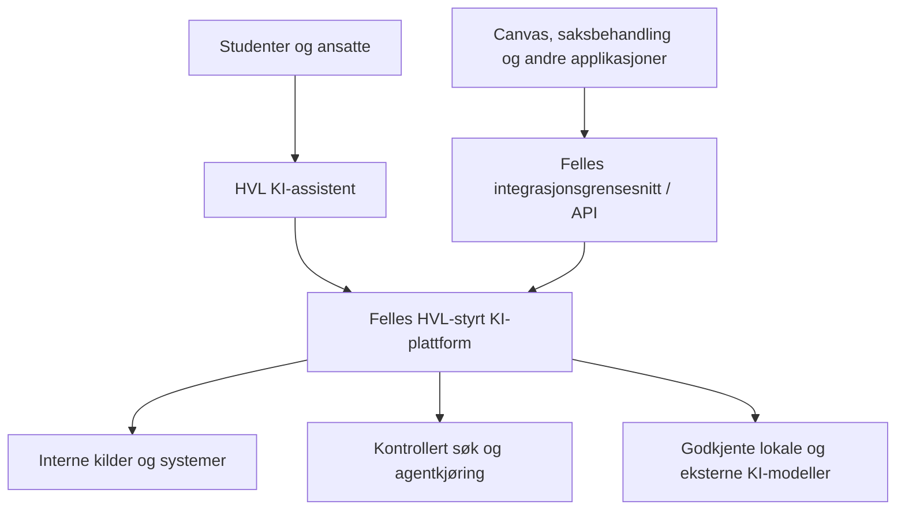
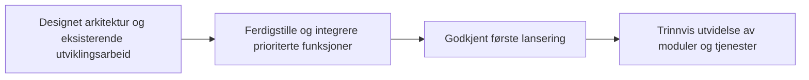

**Prodekanforum for KI og digitalisering · Utfyllende beslutningsgrunnlag**

[Tilbake til kortversjonen](./intro.mdx)

## 1. Dagens KI-tilbud er ikke tilstrekkelig

HVL tilbyr i dag blant annet UiO-GPT og Microsoft Copilot. En enkel chat med tilgang til en språkmodell dekker grunnleggende behov, men er ikke lenger tilstrekkelig som generelt KI-tilbud for studenter og ansatte.

Brukerne etterspør funksjonalitet de kjenner fra blant annet Claude, ChatGPT og Googles KI-tjenester: dokumentarbeid, søk, hukommelse, verktøy, agenter og selvstendig utførelse av sammensatte oppgaver.

**Nettsøk og faktisk bruk.** Tilbakemeldinger fra ansatte peker på manglende nettsøk som en sentral grunn til at de ikke bruker tidligere HVL KI, Sikt KI og UiO-GPT. Personvern og informasjonssikkerhet er sentrale hensyn når slike tjenester begrenser nettsøk. Prosjektets hypotese er at muligheten for å hente aktuell informasjon fra nettet med kildehenvisninger også er en viktig grunn til at ansatte velger private abonnementer på ChatGPT, Claude og lignende tjenester. Dette er en hypotese basert på tilbakemeldinger, ikke en dokumentert kartlegging av omfang eller årsaker. HVL har identifisert SearXNG som en søkeløsning som kan driftes internt, med styring av søkeleverandører og utgående søkeforespørsler. Intern drift betyr ikke at alle søkedata forblir ved HVL: løsningen må konfigureres, testes og godkjennes med hensyn til personvern og informasjonssikkerhet. Målet er å tilby kontrollert nettsøk fra første lansering og dermed gjøre det institusjonelle tilbudet mer attraktivt.

Ønsket om lisenser til internasjonale tjenester handler i stor grad om mulighetene brukerne savner i dagens tilbud. Ambisjonen er å dekke mange av disse behovene internt, med funksjonalitet vesentlig nærmere de store internasjonale løsningene enn de grunnleggende norske chattilbudene fra UiO og Sikt. Vi trenger ikke full funksjonsparitet for å gi brukerne et attraktivt alternativ.

Samtidig må HVL kunne gi KI tilgang til interne informasjonskilder og fagsystemer på en forsvarlig måte. Eksterne KI-tjenester kan ikke uten videre få slike tilganger. Personvern, informasjonssikkerhet, leverandørvilkår og kontroll med handlinger må være ivaretatt. Også nettsøk krever et behandlingsoppsett som HVL kan godkjenne.

## 2. Forslaget: HVLs eget KI-økosystem

**Målet er at første godkjente versjon av HVLs KI-tjeneste skal kunne erstatte behovet for UiO-GPT som grunnleggende KI-chat, og tilby vesentlig mer funksjonalitet.**

Vi skal ikke konkurrere med Anthropic, OpenAI eller Google om å utvikle grunnmodeller eller kopiere hele deres produktporteføljer. Vi kan bruke godkjente modeller fra flere leverandører og bygge et langt mer anvendelig tjenestelag selv, tilpasset HVL.

| Funksjon | Hva HVL ønsker å tilby |
|---|---|
| Moderne KI-assistent | Chat, dokumenter, kontekst og hukommelse innenfor godkjente rammer. |
| Interne informasjonskilder | Søk og kildebaserte svar med brukerens tillatte tilganger. |
| Interne systemintegrasjoner | Kontrollerte oppslag og handlinger gjennom godkjente verktøy. |
| Nettsøk | Lanseringskrav: kontrollert søk, innholdshenting og kildebaserte svar med etterprøvbare referanser. |
| Agenter og multiagentsystemer | KI som kan planlegge, delegere, bruke verktøy og utføre oppgaver i avgrensede kjøremiljøer. |
| Gjenbruk og kvalitet | Delbare agenter, systematiske evalueringer, kvalitetskontroll og sporbarhet. |

Dette er funksjoner i målbildet. Første versjon skal tilby chat og enkle assistenter, god dokumentforståelse med kildebaserte svar, personlig hukommelse, modellvalg, bildegenerering og **nettsøk med kildehenvisninger**. Nettsøk er et lanseringskrav fordi det er viktig for brukernes daglige nytte. Et kontrollert API skal være på plass fra første versjon; publisering av egne agenter som API-er planlegges ved lansering eller i neste delleveranse.

 Konkret omfang ved første lansering må prioriteres; ikke alle funksjoner må være like omfattende som i kommersielle Enterprise-produkter.

## 3. To innganger fra første versjon – én felles KI-plattform

- **For mennesker:** Et moderne chatgrensesnitt der studenter og ansatte kan bruke KI direkte.
- **For applikasjoner:** Et felles integrasjonsgrensesnitt (API) som gjør at HVLs utviklere kan bygge KI og agenter direkte inn i nye og eksisterende verktøy.

En saksbehandler kan få hjelp til å kontrollere dokumentasjon og utarbeide et saksnotat i selve saksbehandlingsapplikasjonen. I Canvas kan vi utvikle emnetilpassede læringsverktøy og agentbaserte utvidelser innenfor faglærerens pedagogiske rammer. Brukeren trenger ikke åpne en separat KI-chat.

Begge inngangene benytter de samme felles plattformtjenestene, med formålsbestemte tilganger, kvalitetssikring og sporbarhet.

HVL kan eie brukerrelasjonen, integrasjonene og styringen av data og agenthandlinger, samtidig som vi utnytter utviklingen hos modellleverandørene. Det gir et annet handlingsrom enn en frittstående ekstern chat.

Egen drift gir muligheter for kontroll, men er ikke alene tilstrekkelig for GDPR-etterlevelse. Tilgang, dataminimering, modellvalg, isolasjon, evaluering og sporbarhet må håndheves og dokumenteres. Interne systemer beholder sine tilgangsregler.

## 4. En grunnmur for hele HVL

KI-assistenten og integrasjonsgrensesnittet er de to inngangene fra første versjon. Plattformen åpner dermed for utvikling av flere spesialiserte tjenester som:

- Faglærerstyrt personlig læringsstøtte og samarbeidslæring i Canvas.
- Videreutvikling av Mime for student- og ansattservice.
- KI-støtte i saksbehandling og andre administrative fagsystemer.
- **SILAF:** KI-chat og spesialiserte forskningsverktøy for forskere og masterstudenter i HVLs forskningsmiljø, med særskilte sikkerhetsmekanismer og begrensninger.

På SILAF kan KI komme til forskerens arbeidsmiljø, fremfor at forskeren må flytte data til en ekstern KI-tjeneste. Systemet begrenser automatisk hvilke KI-modeller, agenter og funksjoner som er tilgjengelige på SILAF, ut fra sikkerhetskravene i forskningsmiljøet og prosjektet. Forskeren får dermed bare tilgang til godkjente alternativer. Se [fordypning om SILAF](./fordypning.mdx).

Felles komponenter kan gjenbrukes på tvers av fakulteter og tjenester. Canvas er et eksempel på hva grunnmuren muliggjør, ikke en forutsetning for satsingen.

Retningen samsvarer med flere temaer i Malthe-Sørenssen-utvalgets NOU 2026: 14, blant annet fagtilpasning, forvaltning, digital suverenitet og samarbeid. Se [prosjektets gjennomgang av kapittel 4 og 8](../interessenter/nou-2026-14.mdx). HVL vil aktivt søke utviklingssamarbeid i sektoren, med Universitetet i Bergen (UiB) som første dialogpartner. Det er gitt klarsignal til å innlede dialog, men ingen samarbeidsavtale er inngått.

Ut fra dialogen vi hittil har hatt med sektoren, er vårt inntrykk at mye av utviklingsarbeidet vi kjenner til, ligger nærmere en grunnleggende KI-chat som UiO-GPT enn et helhetlig, agentbasert økosystem. Det gir HVL en mulighet til å bidra med en mer ambisiøs, gjenbrukbar arkitektur og invitere andre institusjoner inn i felles utvikling. Dette er prosjektets erfaringsbaserte situasjonsbilde, ikke en fullstendig kartlegging av sektoren.

## 5. Vi starter ikke på bar bakke – kortere vei til første lansering

Prosjektet er ambisiøst, men prosjektgruppens vurdering er at det er gjennomførbart med kompetansen vi allerede har i HVL, forutsatt prioritering og dedikerte ressurser. Arkitekturen er allerede designet, og betydelig utviklingsarbeid er gjennomført. Det vi ber om nå, er forankring og ressurser til å videreføre, integrere, kvalitetssikre og ferdigstille arbeidet, ikke å starte et helt nytt prosjekt fra bunnen av.

**Vi bygger videre på etablerte verktøy med åpen kildekode.** Vi har allerede tatt i bruk [LangGraph](https://github.com/langchain-ai/langgraph) i utviklingsarbeidet for å organisere agenters arbeidsflyt og samspill. Før nye komponenter innføres, vurderer vi blant annet informasjonssikkerhet, lisensvilkår, vedlikehold, driftsbehov og egnethet for HVLs infrastruktur og arkitektur. Slik kan vi konsentrere utviklingsressursene om integrasjoner, sikkerhet, styring og funksjonalitet som er spesifikk for HVL, fremfor å utvikle generelle byggeklosser på nytt. Gjenbruk erstatter ikke testing eller sikkerhetsgodkjenning av den samlede tjenesten.

Chat og enkle assistenter bygger på eksisterende frontend og backend. Grunnleggende RAG, promptbasert bildegenerering og et blokkbasert arbeidsområde (Notebook) har fungerende grunnimplementasjoner. Personlig hukommelse, dokumentbehandling, grafbasert agentbygger og lydtjenester er under utvikling. Dette er prosjektets rapporterte status, ikke verifisert produksjonsmodenhet.

Utviklingen skjer modulært og trinnvis, også innenfor hver modul. Teamet etablerer først en sammenhengende grunnversjon av hver prioritert komponent, med felles kontrakter og kontinuerlig integrasjon. Arbeidet styres av detaljerte krav, tekniske spesifikasjoner, tester og menneskelig kodegjennomgang, med GitHub Copilot som utviklingsstøtte. Tale-til-tekst og stemmesamtaler på norsk og engelsk prioriteres tidlig, blant annet for tilgjengelighet. Podcastgenerering vurderes senere; videogenerering har svært lav prioritet. Vi kan prioritere en sammenhengende første versjon som dekker de viktigste brukerbehovene, og deretter utvide funksjonaliteten uten å vente på at hele økosystemet er ferdig.

Dette kan gi en relativt kort vei til første lansering. Konkret lanseringstidspunkt avhenger av kapasitet, faktisk modenhet, integrasjon, testing og nødvendige godkjenninger. En første versjon er ikke det samme som en ferdig utbygd plattform.

## 6. Beslutningspunkter – hva trenger prosjektet nå?

Prodekanforum bes støtte følgende anbefalinger til HVLs ledelse:

| Beslutningspunkt | Hva må forankres? |
|---|---|
| **1. Strategisk prioritering** | Etabler HVLs KI-økosystem som et prioritert strategisk utviklingsprosjekt med tydelig mandat, prosjekteier og avsatt kapasitet. Første hovedleveranse er moderne KI-chat og integrasjonsgrensesnitt for HVLs applikasjoner. |
| **2. Dedikerte utviklerressurser** | Foreslått team: fem deltidsutviklere og en prosjektleder, med avtalte ressursandeler og spesialansvar. To utviklere i andre deler av organisasjonen har relevant kompetanse og ønsker å bidra. De må formelt frikjøpes eller få en avtalt, skjermet andel av arbeidstiden dedikert til prosjektet. |
| **3. Forpliktende bidrag fra ITT** | Involver System og infrastruktur, Informasjonsforvaltning og -sikkerheit og Brukarretta tenester fra starten, med avtalte ressurser og ansvar i samarbeid med Digital tenesteutvikling. |
| **4. Sektorsamarbeid** | Støtt aktivt utviklingssamarbeid i UH-sektoren, med UiB som første dialogpartner, om felles utvikling, gjenbruk og nasjonale KI-tjenester. |
| **5. Regnekraft og investeringer** | Gi mandat til å utrede behovet for ytterligere lokal KI-maskinvare. Et mulig investeringsbehov på rundt 2 millioner kroner på sikt er en foreløpig størrelsesorden, ikke et kostnadsestimat eller en innkjøpsbeslutning. |

**Hvorfor involvere hele ITT tidlig?** System og infrastruktur må bidra med nettverk, drift og kapasitet. Informasjonsforvaltning og -sikkerheit må bidra til at sikkerhet og personvern bygges inn fra start. Brukarretta tenester har innsikt i behovene studenter og ansatte melder inn, og må delta i prioritering, utprøving, opplæring og brukerstøtte – ikke først etter lansering.

Fire Dell-maskiner med GB10 er anskaffet for utvikling, testing og gradvis lokal produksjon, supplert med godkjente eksterne modeller. Mulig tilgang til nasjonal kapasitet må avklares. Høyere ambisjoner om digital suverenitet og lokal modellkjøring kan kreve større egne investeringer, særlig frem til egnede nasjonale tjenester er tilgjengelige. Omfanget av lokal kapasitet skal vurderes mot sikkerhetskrav, etterspørsel og samlet kostnad. Se [fordypning om ressurser og investeringer](./fordypning.mdx).

Det som trengs nå, er en reell prioritering og tilgang til mennesker med riktig kompetanse. Mandat, ressursandeler og finansiering må besluttes av rett myndighet. Maskinvareanskaffelse behandles separat når behovet er dokumentert. UiO-GPT fases først ut når erstatningen er godkjent og driftsklar; Microsoft Copilot omfattes ikke automatisk.

---

**Dette er hovedbildet.** Les eventuelt [fordypning og diskusjonsspørsmål](./fordypning.mdx), eller gå til [interessentløpet](../interessenter/intro.mdx).
