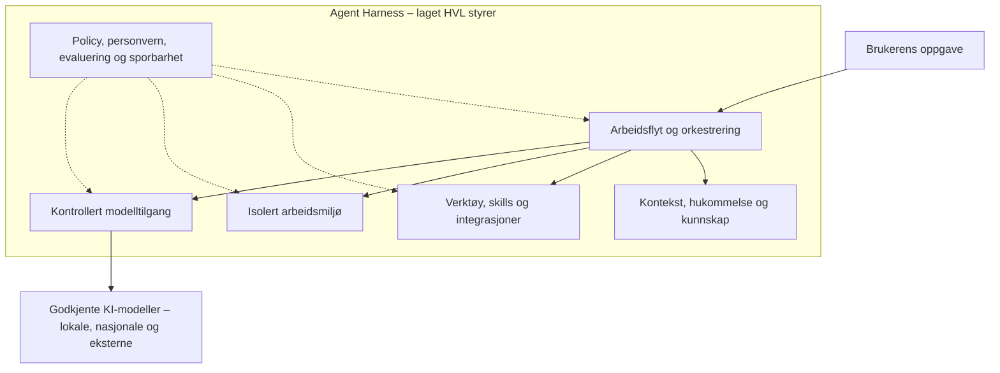

## Fra å svare til å utføre arbeid

En språkmodell behandler kontekst og genererer svar eller forslag til handlinger. En enkel KI-chat gir brukeren en samtale med modellen. Et agentisk KI-system kan i tillegg la modellen arbeide mot et mål gjennom flere steg, bruke verktøy, undersøke resultater og tilpasse neste handling.

| Enkel KI-chat | Agentisk KI-system |
|---|---|
| Svarer på spørsmål | Kan planlegge og utføre en oppgave |
| Analyserer vedlagt informasjon | Kan hente tillatt informasjon selv |
| Foreslår handlinger | Kan utføre godkjente handlinger |
| Genererer tekst og kode | Kan kjøre kode og produsere ferdige filer |
| Reagerer på brukerens spørsmål | Kan arbeide videre over tid og ved avtalte hendelser |

Flere agenter kan også samarbeide, eksempelvis ved at én innhenter kilder, en annen analyserer dem og en tredje kontrollerer leveransen. Autonomien tilpasses oppgaven; en enkel forespørsel krever ikke et komplekst agentsystem.

## Hva er en Agent Harness?

En språkmodell alene har ikke vedvarende hukommelse, tilgang til HVLs systemer eller en egen datamaskin. **Agent Harness** er apparatet rundt modellen som gjør slike funksjoner tilgjengelige, koordinerer arbeidet og håndhever grensene for hva agenten kan gjøre.

Harness samler blant annet:

| Funksjon | Hva den gir agenten |
|---|---|
| Hukommelse og kunnskap | Relevant kontekst fra tidligere arbeid og institusjonens informasjonskilder. |
| Verktøy og skills | Godkjente systemfunksjoner og gjenbrukbare faglige arbeidsmetoder. |
| Arbeidsmiljø | Avgrenset datamaskin for kode, filer, nettleser og dokumentproduksjon. |
| Orkestrering | Planlegging, fremdrift, samarbeid mellom agenter og kontroll av resultater. |
| Kontroll og kvalitet | Tillatelser, ressursgrenser, avbrudd, evaluering og revisjonsspor. |

Dette tjenestelaget er i stor grad det som skiller moderne produkter som ChatGPT og Claude fra enkel tilgang til en språkmodell.

## Hvorfor kontrollen må ligge hos HVL

Når en agent skal hente interne dokumenter eller utføre en handling i et fagsystem, må HVL kontrollere brukeridentiteten, hvilke data som utleveres, hvilke rettigheter agenten får, og hva den kan gjøre på brukerens vegne. Fagmiljøene må kunne definere arbeidsmetoder og kvalitetskrav. Handlinger med vesentlige konsekvenser krever passende menneskelig kontroll.

Med et HVL-styrt tjenestelag kan identitet, hukommelse og integrasjoner holdes under institusjonell kontroll, mens modellene kan byttes ut etter oppgave, sikkerhetskrav, kvalitet og kostnad. En ekstern modell får bare den konteksten som er godkjent for behandlingen, ikke direkte tilgang til fagsystemene. Egen infrastruktur gir kontrollmuligheter, men sikkerhet og etterlevelse må dokumenteres.

**Vi trenger ikke utvikle egne språkmodeller.** Vi kan utnytte utviklingen hos kommersielle og nasjonale modelltilbydere, samtidig som HVL styrer hvordan modellene brukes. Agent Harness er en samlet arkitektur av gjenbrukbare komponenter, ikke et krav om å bygge alle komponentene fra bunnen av.

[Hvordan sikkerheten ivaretas](./sikkerhet.mdx) · [Hva dette kan brukes til](./brukseksempler.mdx) · [Teknisk arkitektur for HVL Agent Harness](../utviklere/agent-harness.mdx)
