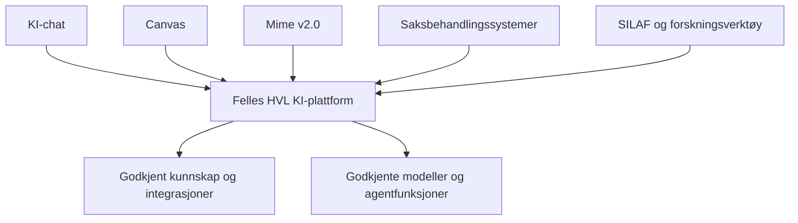

HVLs felles plattform kan brukes fra chatten og gjennom et kontrollert API i andre applikasjoner. Eksemplene er anvendelsesmuligheter, ikke krav om at alle tjenestene skal være ferdige ved første generelle lansering.

| Tjeneste | Konkret arbeidsoppgave |
|---|---|
| Canvas | En student får emnetilpassede forklaringer, hint og formative tilbakemeldinger innenfor faglærerens pedagogiske rammer. |
| Mime v2.0 | En student får svar på en eksamensfrist med kilde, og henvises videre når individuell vurdering kreves. |
| Saksbehandling | En medarbeider får sammenstilt dokumentasjon, relevant regelverk og et utkast til saksnotat i fagsystemet. Saksbehandleren tar beslutningen. |
| Forskning | En forsker analyserer et godkjent datasett, kjører kode i isolert miljø og får et dokument med etterprøvbare resultater. |

## KI i forskningsmiljøet SILAF

KI-chat og forskningsverktøy kan på sikt tilbys forskere og masterstudenter i SILAF med en strengere sikkerhetsprofil. Eksempler er dokumentanalyse, transkripsjon, kvalitativ analyse og programmeringsstøtte.

Bare modeller og funksjoner som er godkjent for miljøet og prosjektets data gjøres tilgjengelige. Nettsøk, integrasjoner, filoverføring og agenthandlinger begrenses eller deaktiveres etter policy. Samtaler, minne, artefakter og logger holdes innenfor godkjente prosjektgrenser. Forskningsdata flyttes ikke automatisk til den generelle KI-tjenesten.

SILAFs tjenesteeier og relevante sikkerhets- og personvernfunksjoner må avklare behandlingsmiljøet før bruk.

## Hva kan en utdanningspilot vise?

En pilot bør undersøke læringsutbytte og selvstendighet, om assistenten følger faglærerens rammer, likeverdig tilgang og språk, og om data og kilder behandles forsvarlig. Kvalitet, responstid, kostnader, vedlikeholdsbehov og gjenbruk mellom emner bør også måles. Fagmiljøene fastsetter kriterier og testdesign før utprøving.

[Mer om Canvas, Mime, saksbehandling og forskningsstøtte](../interessenter/skreddersydde-tjenester.mdx)
