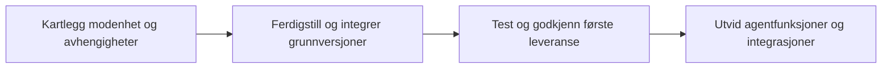

## Vi starter ikke på bar bakke

Følgende er prosjektets rapporterte utviklingsstatus. Produksjonsmodenhet og samspill må verifiseres før lansering.

| Område | Status |
|---|---|
| Chat og enkle assistenter | Eksisterende frontend og backend. |
| Grunnleggende RAG, promptbasert bildegenerering og Notebook | Fungerende grunnimplementasjoner. |
| Personlig hukommelse, dokumentbehandling, grafbasert agentbygger og lydtjenester | Under utvikling. |
| Orkestrering | LangGraph er tatt i bruk i utviklingsarbeidet. |

Gjenbruk av åpen kildekode reduserer behovet for å bygge generelle komponenter på nytt. Sikkerhet, lisens, vedlikehold og egnethet må vurderes. Arbeidet styres av krav, tekniske spesifikasjoner, tester og menneskelig kodegjennomgang, med GitHub Copilot som utviklingsstøtte.

## Trinnvis gjennomføring

| Første leveranse | Videre utvikling |
|---|---|
| Chat, enkle assistenter, hukommelse, dokumentbaserte svar, modellvalg og bildegenerering. | Avansert agentbygger, deling, multiagent, isolert utførelse og automatisering. |
| Kontrollert nettsøk med kildehenvisninger – lanseringskrav. | Flere godkjente systemintegrasjoner og arbeidsprosesser. |
| Kontrollert applikasjons-API. Agentpublisering som API ved lansering eller i neste delleveranse. | Skreddersydde tjenester i Canvas, Mime, administrasjon og SILAF. |

Tale-til-tekst og stemmesamtaler på norsk og engelsk prioriteres tidlig, blant annet for tilgjengelighet. Podcastgenerering vurderes senere; videogenerering har svært lav prioritet.

## Når kan UiO-GPT erstattes?

Første versjon må være godkjent og driftsklar, med dokumentert kvalitet, nettsøk, brukervennlighet, personvern, sikkerhet, tilgjengelighet, kostnader, support og migreringsplan. Mandatet må fastsette nærmere akseptansekriterier. Microsoft Copilot har egne bruksområder og omfattes ikke automatisk av en utfasing.

Trinnene er ikke en kalenderfestet plan. Lansering avhenger av kapasitet, modenhet, integrasjon, testing og nødvendige godkjenninger.

[Utviklerdokumentasjon](../utviklere/intro.mdx) · [Åpne arkitekturvalg](../utviklere/arkitekturavklaringer.mdx)
