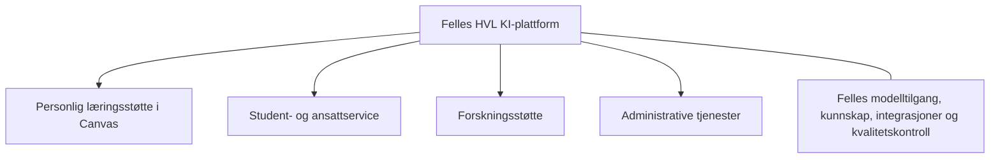

**Prodekanforum for KI og digitalisering · Forslag til oppstart · Ca. 5 minutters lesing**

## 1. Hva ønsker vi å beslutte?

**Anbefaling:** Still dere bak at HVL starter et avgrenset, tverrfaglig arbeid med å utvikle et felles KI-økosystem, med utdanningsfaglige behov som en sentral drivkraft. Arbeidet skal frembringe en demonstrerbar løsning, et kunnskapsgrunnlag og en anbefaling om videre satsing.

Dette er et forslag om å starte arbeidet, ikke om å godkjenne full utbygging, innkjøp eller produksjonsbruk. En eventuell ressursbeslutning må tas av riktig beslutningsmyndighet.

## 2. Hvorfor nå?

HVL har allerede UiO-GPT og Microsoft Copilot. Samtidig etterspør brukere mer funksjonsrike KI-tjenester, eksempelvis Claude, som kan arbeide med større oppgaver, kunnskapskilder og andre systemer.

Enkeltstående verktøy kan løse mange behov, men gir også risiko for fragmentert kontekst, ulik tilgang og gjentatte vurderinger av integrasjoner, personvern og sikkerhet. Eksterne agenter kan ikke uten videre få tilgang til interne HVL-systemer. Fagmiljøene trenger dessuten mer enn generell chat: de må kunne forme KI-støtten etter pedagogiske og faglige behov.

Spørsmålet er derfor ikke bare hvilken KI-modell HVL skal tilby, men hvordan institusjonen skal kunne utvikle og forvalte egne KI-tjenester over tid.

## 3. Forslaget: én grunnmur, mange tjenester

HVL utvikler et modulært tjenestelag med felles tilgang til godkjente modeller, kunnskapskilder, verktøy og agenter. Det skal kunne brukes fra eksisterende systemer, ikke bare fra en ny chat. Modeller kan byttes eller suppleres uten at alle tjenester bygges om.

Felles personvern, tilgangsstyring, avgrensede kjøremiljøer, evaluering og sporbarhet bygges inn fra start. Fagmiljøene beholder ansvaret for formål og kvalitet. Dette er ikke et forslag om å utvikle egne grunnmodeller eller erstatte alle eksisterende tilbud.

## 4. Hva kan utdanningen få igjen?

**Eksempel: personlig læringsstøtte i Canvas.** Faglærer setter rammer ut fra emnets læringsutbytte, pensum, oppgaver og vurderingskriterier. Studenten får veiledning, hint, øving og formative tilbakemeldinger – ikke automatisk ferdige svar. Tjenesten kan også støtte samarbeidslæring og dialog med faglærer.

På sikt kan læringsstøtten følge studenten på tvers av emner innenfor avklarte personvernrammer. Faglærerstyring skal ikke innebære automatisk innsyn i private studentsamtaler.

Gevinstene vi ønsker å undersøke:

- Bedre tilpasset læringsstøtte og likeverdig tilgang.
- Større faglig og pedagogisk handlingsrom for undervisere.
- Gjenbruk av løsninger og erfaringer på tvers av fakulteter.
- Mer kontroll over data, integrasjoner, ressursbruk og leverandøravhengighet.

Dette er forventede muligheter, ikke dokumenterte gevinster.

## 5. Hvorfor felles, og hvorfor samarbeid?

Malthe-Sørenssen-utvalgets NOU 2026: 14 løfter blant annet fagtilpasning, institusjonell forvaltning, digital suverenitet og samarbeid i sektoren. Prosjektets målarkitektur er utformet for å møte flere av disse behovene; se [prosjektets gjennomgang av kapittel 4 og 8](../interessenter/nou-2026-14.mdx).

HVL bør undersøke samarbeid med UiB og andre relevante UH-aktører om gjenbrukbare komponenter og felles utvikling, samt benytte nasjonal infrastruktur der det er egnet. Lokal faglig tilpasning kan kombineres med felles sektorløsninger. Samarbeidets omfang og finansiering er ikke avklart.

## 6. Fra idé til beslutning om videre satsing

| Første arbeidsfase | Hva skal leveres? |
|---|---|
| Forankre behov | Fagmiljøer, studenter, IT, personvern og sikkerhet velger en avgrenset utdanningscase og målekriterier. |
| Utvikle og prøve | Demonstrer gjenbrukbar plattformfunksjonalitet og en læringsstøtte i avgrenset testmiljø. Bruk godkjente testdata. |
| Evaluere | Undersøk læringsverdi, faglig kvalitet, sikkerhet, tilgjengelighet, ressursbruk og gjennomførbarhet. |
| Anbefale neste steg | Legg frem ressursbehov, samarbeid, risiko, forvaltning og alternativer for videre beslutning. |

**Forslag til anbefaling fra prodekanforum:**

- Støtte oppstart av et avgrenset, tverrfaglig arbeid med HVLs KI-økosystem.
- Bidra til å identifisere fagmiljøer og utdanningsbehov for en første pilot.
- Be om at mandat, nødvendige ressurser og mulig sektorsamarbeid avklares, og at resultatene legges frem for ny beslutning før eventuell videre utrulling.

Omfang, finansiering, ansvarlig eier og tidsplan må konkretiseres i oppstartsmandatet. Ingen produksjonssetting eller behandling av studentdata følger automatisk av en slik anbefaling.

---

**Dette er hovedbildet.** For mer om alternativer, kontroll og hvordan en pilot kan vurderes, se [Fordypning og spørsmål til diskusjon](./fordypning.mdx). For hele arkitektur- og funksjonalitetsbeskrivelsen, se [interessentløpet](../interessenter/intro.mdx).
