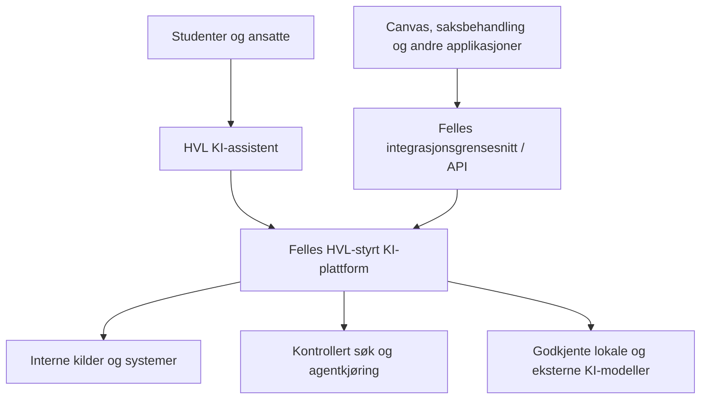
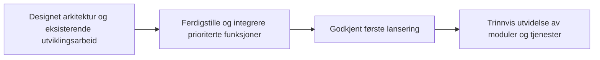

**Prodekanforum for KI og digitalisering · Forslag til oppstart · Ca. 4–5 minutters lesing**

## 1. Dagens KI-tilbud er ikke tilstrekkelig

HVL tilbyr i dag blant annet UiO-GPT og Microsoft Copilot. En enkel chat med tilgang til en språkmodell dekker grunnleggende behov, men er ikke lenger tilstrekkelig som generelt KI-tilbud for studenter og ansatte.

Brukerne etterspør funksjonalitet de kjenner fra blant annet Claude, ChatGPT og Googles KI-tjenester: dokumentarbeid, søk, hukommelse, verktøy, agenter og selvstendig utførelse av sammensatte oppgaver.

Ønsket om lisenser til internasjonale tjenester handler i stor grad om mulighetene brukerne savner i dagens tilbud. Ambisjonen er å dekke mange av disse behovene internt, med funksjonalitet vesentlig nærmere de store internasjonale løsningene enn de grunnleggende norske chattilbudene fra UiO og Sikt. Vi trenger ikke full funksjonsparitet for å gi brukerne et attraktivt alternativ.

Samtidig må HVL kunne gi KI tilgang til interne informasjonskilder og fagsystemer på en forsvarlig måte. Eksterne KI-tjenester kan ikke uten videre få slike tilganger. Personvern, informasjonssikkerhet, leverandørvilkår og kontroll med handlinger må være ivaretatt. Også nettsøk krever et behandlingsoppsett som HVL kan godkjenne.

## 2. Forslaget: HVLs eget KI-økosystem

**Målet er at første godkjente versjon av HVLs KI-tjeneste skal kunne erstatte behovet for UiO-GPT som grunnleggende KI-chat, og tilby vesentlig mer funksjonalitet.**

Vi skal ikke konkurrere med Anthropic, OpenAI eller Google om å utvikle grunnmodeller eller kopiere hele deres produktporteføljer. Vi kan bruke godkjente modeller fra flere leverandører og bygge et langt mer anvendelig tjenestelag selv, tilpasset HVL.

| Funksjon | Hva HVL ønsker å tilby |
|---|---|
| Moderne KI-assistent | Chat, dokumenter, kontekst og hukommelse innenfor godkjente rammer. |
| Interne informasjonskilder | Søk og kildebaserte svar med brukerens tillatte tilganger. |
| Interne systemintegrasjoner | Kontrollerte oppslag og handlinger gjennom godkjente verktøy. |
| Nettsøk | En HVL-kontrollert, eventuelt selvhostet søkeløsning med nødvendige personvern- og sikkerhetsvurderinger. |
| Agenter og multiagentsystemer | KI som kan planlegge, delegere, bruke verktøy og utføre oppgaver i avgrensede kjøremiljøer. |
| Gjenbruk og kvalitet | Delbare agenter, systematiske evalueringer, kvalitetskontroll og sporbarhet. |

Dette er funksjoner i målbildet. Konkret omfang ved første lansering må prioriteres; ikke alle funksjoner må være like omfattende som i kommersielle Enterprise-produkter.

## 3. To innganger fra første versjon – én felles KI-plattform

- **For mennesker:** Et moderne chatgrensesnitt der studenter og ansatte kan bruke KI direkte.
- **For applikasjoner:** Et felles integrasjonsgrensesnitt (API) som gjør at HVLs utviklere kan bygge KI og agenter direkte inn i nye og eksisterende verktøy.

En saksbehandler kan få hjelp til å kontrollere dokumentasjon og utarbeide et saksnotat i selve saksbehandlingsapplikasjonen. I Canvas kan vi utvikle emnetilpassede læringsverktøy og agentbaserte utvidelser innenfor faglærerens pedagogiske rammer. Brukeren trenger ikke åpne en separat KI-chat.

Begge inngangene benytter de samme felles plattformtjenestene, med formålsbestemte tilganger, kvalitetssikring og sporbarhet.

HVL kan eie brukerrelasjonen, integrasjonene og styringen av data og agenthandlinger, samtidig som vi utnytter utviklingen hos modellleverandørene. Det gir et annet handlingsrom enn en frittstående ekstern chat.

Egen drift gir muligheter for kontroll, men er ikke alene tilstrekkelig for GDPR-etterlevelse. Tilgang, dataminimering, modellvalg, isolasjon, evaluering og sporbarhet må håndheves og dokumenteres. Interne systemer beholder sine tilgangsregler.

## 4. En grunnmur for hele HVL

KI-assistenten og integrasjonsgrensesnittet er de to inngangene fra første versjon. Plattformen åpner dermed for spesialiserte tjenester som:

- Faglærerstyrt personlig læringsstøtte og samarbeidslæring i Canvas.
- Videreutvikling av Mime for student- og ansattservice.
- KI-støtte i saksbehandling og andre administrative fagsystemer.
- **SILAF:** KI-chat og spesialiserte forskningsverktøy for forskere og masterstudenter i HVLs forskningsmiljø, med særskilte sikkerhetsmekanismer og begrensninger.

På SILAF kan KI komme til forskerens arbeidsmiljø, fremfor at forskeren må flytte data til en ekstern KI-tjeneste. Systemet begrenser automatisk hvilke KI-modeller, agenter og funksjoner som er tilgjengelige på SILAF, ut fra sikkerhetskravene i forskningsmiljøet og prosjektet. Forskeren får dermed bare tilgang til godkjente alternativer. Se [fordypning om SILAF](./fordypning.mdx).

Felles komponenter kan gjenbrukes på tvers av fakulteter og tjenester. Canvas er et eksempel på hva grunnmuren muliggjør, ikke en forutsetning for satsingen.

Retningen samsvarer med flere temaer i Malthe-Sørenssen-utvalgets NOU 2026: 14, blant annet fagtilpasning, forvaltning, digital suverenitet og samarbeid. Se [prosjektets gjennomgang av kapittel 4 og 8](../interessenter/nou-2026-14.mdx). HVL bør undersøke utviklingssamarbeid med UiB og andre UH-aktører og gjenbruke nasjonal infrastruktur der det er egnet.

## 5. Vi starter ikke på bar bakke – kortere vei til første lansering

Arkitekturen for økosystemet er allerede designet, og betydelig utviklingsarbeid er gjennomført. Det vi ber om nå, er forankring og ressurser til å videreføre, integrere, kvalitetssikre og ferdigstille arbeidet, ikke å starte et helt nytt prosjekt fra bunnen av.

Utviklingen skjer modulært og trinnvis, også innenfor hver modul. Vi kan prioritere en sammenhengende første versjon som dekker de viktigste brukerbehovene, og deretter utvide funksjonaliteten uten å vente på at hele økosystemet er ferdig.

Dette kan gi en relativt kort vei til første lansering. Konkret lanseringstidspunkt avhenger av kapasitet, faktisk modenhet, integrasjon, testing og nødvendige godkjenninger. En første versjon er ikke det samme som en ferdig utbygd plattform.

## 6. Beslutningen vi trenger nå

**Forslag til anbefaling fra prodekanforum:**

- Støtte formell forankring og videreføring av utviklingsarbeidet med HVLs modulære KI-økosystem, med både en moderne KI-assistent og et kontrollert API for integrasjon i HVLs applikasjoner som første hovedleveranse.
- Legge til grunn at tjenesten skal kunne overta for UiO-GPT når den har tilstrekkelig funksjonalitet, dokumentert kvalitet, godkjenning og driftsberedskap.
- Bidra til prioritering av behov, fagmiljøer og videre anvendelser, og støtte avklaring av utviklingssamarbeid, mandat, ressurser og forvaltning.

Første arbeidsfase skal kartlegge modenheten i eksisterende komponenter, konkretisere leveranseomfanget, ferdigstille, integrere og teste kjernen og dokumentere nytte, sikkerhet, kostnader og driftsbehov. En eventuell utfasing av UiO-GPT gjennomføres først når erstatningen er klar. Forslaget innebærer ikke automatisk utfasing av Microsoft Copilot, innkjøp eller produksjonsgodkjenning.

---

**Dette er hovedbildet.** Les eventuelt [fordypning og diskusjonsspørsmål](./fordypning.mdx), eller gå til [interessentløpet](../interessenter/intro.mdx).
