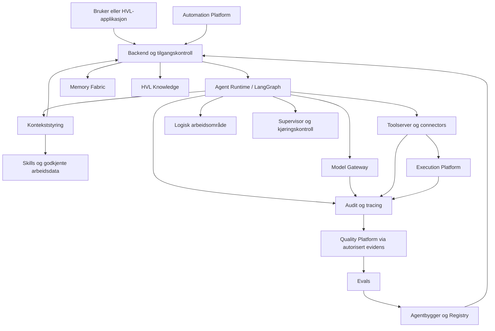
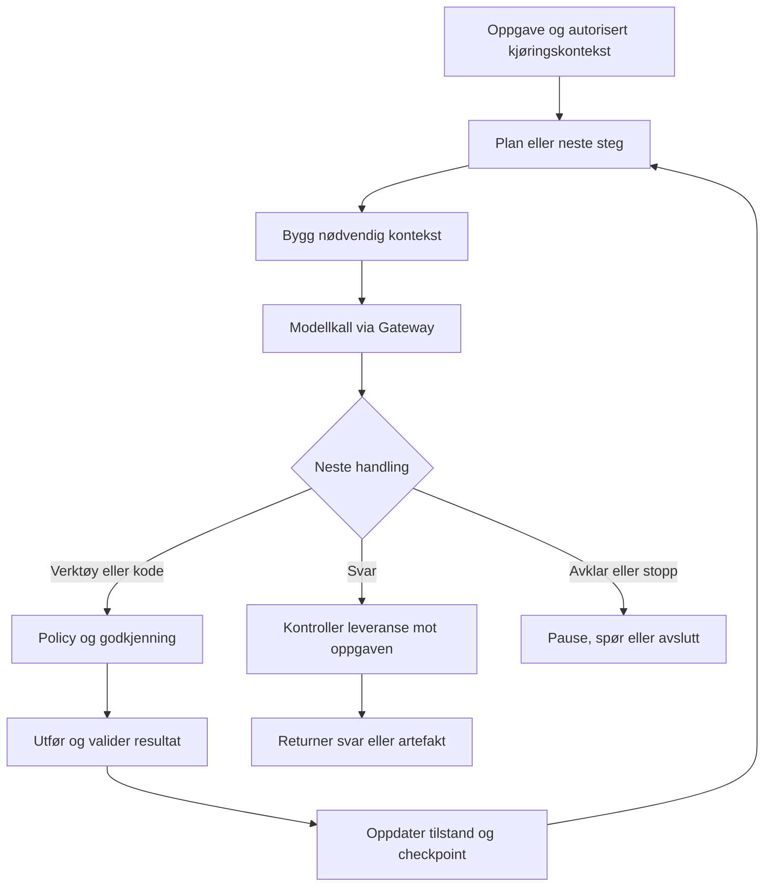

Agent Harness er den samlede arkitekturen som gjør en språkmodell til en operativ, kontrollert agent. Den omfatter instruksjoner, kontekst, verktøy, arbeidsflyt, arbeidsmiljø, tilstand, tilgangskontroll og oppfølging. LangGraph er orkestreringsmotoren i målarkitekturen, ikke hele harness.

HVL Agent Harness er en logisk sammensetning av plattformens tjenester, ikke et krav om en ny monolitt eller en separat container med dette navnet. Den kan brukes både fra KI-chatten og fra skreddersydde tjenester i Canvas, Mime, administrative systemer og forskningsmiljøer.

## Komponenter og ansvar

| Funksjon | Ansvar i arkitekturen |
|---|---|
| Agent Control Plane | Agentbygger, versjonerte definisjoner, Agent Registry, testing, godkjenning og publisering i Agent Library. |
| Agent Runtime | LangGraph-basert orkestrering, agent loop, planlegging, subagenter, tilstand, avbrudd og gjenopptakelse. |
| Model Gateway | Godkjent modellregister, ruting, PII-vask og kontroll av modellkall. |
| Kontekststyring | Sammenstille relevant, tillatt kontekst for hvert modellkall. Context Engine som egen logisk funksjon må konkretiseres. |
| Memory Fabric | Vedvarende kontekst på bruker-, prosjekt- og agentnivå, med kontrollerte scopes. Backend er inngangen til minnelageret. |
| HVL Knowledge | Tilgangsstyrt søk, RAG, kildegrunnlag og versjoner. |
| Toolserver og connectors | Validerte verktøykall og tilgang til eksterne og interne systemer. |
| Skills Library | Gjenbrukbare arbeidsmetoder, instruksjoner og ressurser. |
| Execution Platform | Isolert kodekjøring, Computer Use og virtuelle arbeidsmiljøer. |
| Automation Platform | Planlagte og hendelsesstyrte kjøringer. |
| Evals og Quality Platform | Evaluering, publiseringsporter og kontrollert kvalitetsforbedring. |
| Audit og observability | Revisjonsspor, tracing, driftsmålinger og hendelsesoppfølging. |
| Policy og menneskelig kontroll | Gjennomgående kontroll av identitet, tilganger, dataklasser, budsjett og godkjenninger. |

Diagrammet viser logisk samspill, ikke direkte nettverksrettigheter. Context Engine, Workspace og Supervisor er funksjoner som skal konkretiseres; deres endelige tjenestegrenser er åpne. Policy håndheves ved hvert privilegert kall, ikke bare ved inngangen.

## 1. Agentens arbeidsløp

Backend autentiserer brukeren, validerer oppgaven og etablerer en kjøringskontekst. Runtime velger tillatt agentversjon og bygger opp arbeidsflyten. En enkel chat kan bruke en kort flyt med ett eller flere modellkall; en mer kompleks oppgave kan bruke deloppgaver, subagenter, verktøy og et isolert arbeidsmiljø.

Modellens forslag gir ikke i seg selv autorisasjon. Runtime og ansvarlige tjenester validerer handlingene. Planlegging og iterasjon benyttes når oppgaven krever det, ikke som obligatorisk ekstraarbeid for alle forespørsler.

## 2. Context Engine – kontekststyring per modellkall

Kontekststyring må skilles fra lagring og søk. Memory Fabric lagrer varig minne; Knowledge finner relevante kilder; Runtime holder tilstand. Context Engine er et forslag til en tydelig logisk funksjon som velger og setter sammen informasjonen modellen trenger akkurat nå.

Den må kunne prioritere system- og agentinstruksjoner, brukerens aktuelle oppgave, relevante samtaledeler, tillatt minne, kildeutdrag, skills, verktøyresultater og arbeidsfiler. Ved lange kjøringer må den håndtere tokenbudsjett, selektiv gjenfinning og kontekstkomprimering uten å miste oppgavekritiske opplysninger eller kildeproveniens.

Tilgang og dataklasse må kontrolleres før kontekst settes sammen; ekstern modellbehandling kontrolleres igjen i Model Gateway. Upålitelige dokumenter og verktøyresultater er data, ikke privilegerte instrukser. Komprimering kan miste informasjon og må derfor kunne evalueres; referanser til originalgrunnlaget beholdes der det er nødvendig og tillatt.

Det må avklares om funksjonen plasseres i backend, Runtime eller en gjenbrukbar intern modul/tjeneste. Ingen ny direkte tilgang til Memory Fabric innføres som følge av dette.

## 3. Agent Workspace – logisk arbeidsområde

En kompleks agentoppgave trenger et arbeidsområde som kan overleve at en midlertidig sandbox avsluttes. Workspace er et forslag til en felles logisk modell, ikke nødvendigvis en ny tjeneste.

| Del | Innhold |
|---|---|
| Plan og tasks | Mål, deloppgaver, avhengigheter, status og godkjenningspunkter. |
| Working state | Midlertidig oppgavekontekst og mellomresultater. |
| Files og artifacts | Tillatte arbeidsfiler, produserte dokumenter, kode og analyser. |
| Evidence | Referanser til kilder, versjoner og resultatgrunnlag. |
| Checkpoints | Tilstand som trengs for kontrollert gjenopptakelse. |
| Delegation | Subagentoppgaver, avgrensede rettigheter og resultater. |

Vedvarende metadata og tilstand lagres i ekstern PostgreSQL; godkjente filer og artefakter lagres i ekstern S3-kompatibel objektlagring. Sandboxens lokale filer er midlertidige. Workspace må skille bruker-, prosjekt- og kjøringsscope, og følge dataklassifisering, tilgang, sletting og levetid. Dette er ikke en ny form for automatisk langtidsminne.

Eierskap, persistensnivå, API-er og hvordan Workspace samspiller med Runtime, backend og Memory Fabric må avklares.

## 4. Agent Supervisor – uavhengig kontroll av kjøringen

Runtime trenger en kontrollfunksjon som ikke er avhengig av språkmodellens eget skjønn. Agent Supervisor er et foreslått navn på denne funksjonen.

Den håndhever hardgrenser for tid, tokens, kostnad, antall steg, parallellitet og verktøykall, samt stoppsignaler og godkjenningspauser. Den kan i tillegg oppdage repeterte handlinger, manglende fremdrift og feilsløyfer. Slike heuristikker kan gi feilutslag og må testes. Uautoriserte handlinger avvises alltid i ansvarlig tjeneste, selv om Supervisor ikke oppdager dem.

Pause, kansellering, resume og frislipp av ressurser må ha definerte tilstandsoverganger. Ved avbrudd må systemet vite hvilke eksterne handlinger som allerede er utført; en restart må ikke ukritisk gjenta dem. Endelig plassering og overvåkingsmekanisme er åpne arkitekturvalg.

## 5. Agent Execution Context og delegering

Run Context er allerede del av plattformens planlagte sporbarhet og utførelse. En felles Agent Execution Context er en videre konkretisering av kontrakten, ikke en ny brukeridentitet.

| Feltgruppe | Formål |
|---|---|
| Identitet og scope | Intern pseudonym aktørreferanse, autorisert prosjekt-/brukerscope og eventuell delegert tjenesteidentitet. |
| Kjøring | requestId, runId, parentRunId, agentversjon, trace-korrelasjon. |
| Tilgang | Effektive capabilities, tillatte verktøy, operasjoner, dataklasser og behandlingsmiljøer. |
| Ressurser | Frist, budsjett, parallellitets- og steggrenser. |
| Policy og godkjenning | Gjeldende policyreferanse, godkjenningsstatus og avgrensninger. |

Kontrakten etableres av en betrodd tjeneste, valideres ved hvert kall og kan ikke utvides av modelloutput. Subagenter får bare delegert en delmengde av tillatte rettigheter og budsjett. Tilgang må kontrolleres på nytt ved sensitive handlinger og ved gjenopptakelse, slik at tilbakekalte rettigheter ikke lever videre i en checkpoint. Eksterne modeller får ikke den interne identitetskontrakten.

Format, signering eller referansemodell, levetid, tilbakekalling og eventuell egen Capability Engine må avklares. En foreslått Capability Engine kan være en modul i eksisterende policyfunksjon, ikke nødvendigvis en selvstendig tjeneste.

## 6. Etterprøvbarhet, replay og kvalitet

En kjøring kan undersøkes ved hjelp av observerbare hendelser, agentversjon, modellversjon, kildegrunnlag, verktøykall, godkjenninger og checkpoint-referanser. En foreslått Runtime Inspector kan gi utviklere tilgang til kjøringsgraf, feilsøking og kontrollert replay.

Replay av en agent er ikke nødvendigvis deterministisk: modeller, kilder og eksterne systemer kan ha endret seg. Simulering av eksterne handlinger må som hovedregel bruke mocks eller avgrensede testmiljøer. Produksjonsskriving skal ikke gjentas bare fordi en kjøring spilles av. Tilgang til evidens må begrenses av personvern og sletteregler.

Evals og Quality Platform danner forbedringssløyfen. Offisielle agenter må gjennom obligatoriske evalueringer før publisering. Produksjonsfunn kan gi nye regresjonstester og forbedrede agentversjoner etter menneskelig godkjenning.

Se [åpne arkitekturvalg](./arkitekturavklaringer.mdx), [Agentbygger og Runtime](./agenter.mdx), [Execution Platform](./kjoremiljo.mdx), [Evals](./evaluering.mdx) og [Audit](./sporbarhet.mdx).
