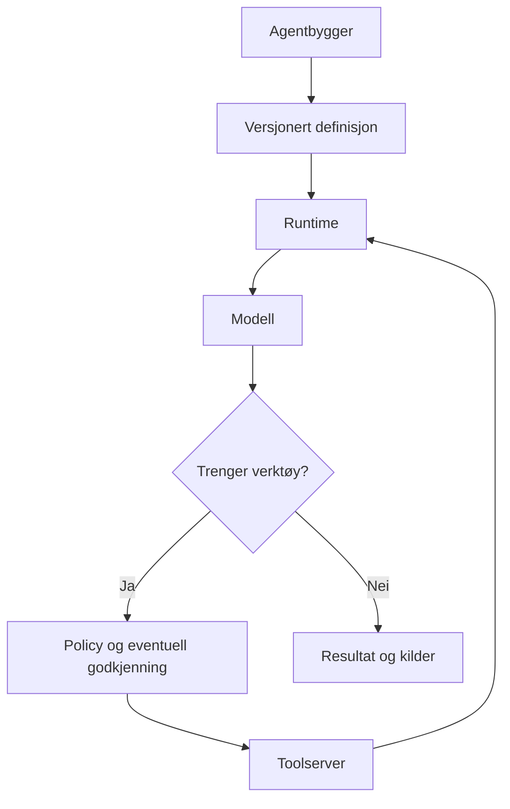

En agent kombinerer mål, instruksjoner, modell, kontekst, skills, tools og policy. Den kan være en enkel assistent eller gjennomføre flere steg. Autonomi er gradert, ikke et krav.

## Agentbygger

Agentbyggeren skal selv kunne bruke KI til å analysere behovet: formål og brukergruppe, kunnskapskilder, memory, tools, skills, modell, arbeidsflyt, kostnad, tilgang, evaluering og godkjenningskrav. Brukeren må kunne endre forslagene og teste før publisering.

Et visuelt grensesnitt kan støtte arbeidsflyter, mens agentdefinisjonen lagres som en versjonert, validerbar konfigurasjon. Valg av editor og konkret skjema må verifiseres mot hovedrepoet.

## Agent Runtime

Agentbyggeren definerer; Runtime kjører. Runtime koordinerer tilstand, modellkall, verktøyresultater, godkjenningssteg, tids- og ressursgrenser og avslutning. LangGraph er en aktuell teknologi. Langvarige kjøringer trenger avbrudd, idempotens og gjenopptakelse der relevant.

**Øvelse:** Skisser en prosjektagent som leser GitHub-oppgaver, men ikke kan endre dem.
