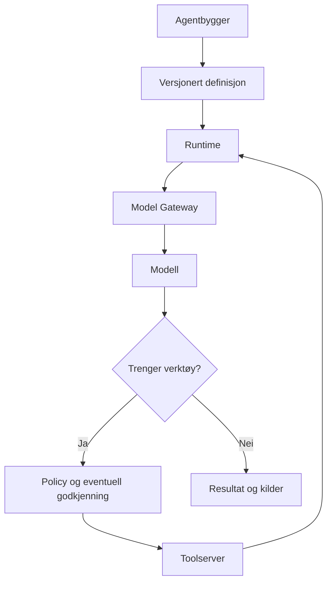

En agent kombinerer mål, instruksjoner, modell, kontekst, skills, tools og policy. Den kan være en enkel assistent eller gjennomføre flere steg. Autonomi er gradert, ikke et krav.

## Agentbygger

Agentbyggeren skal selv kunne bruke KI til å analysere behovet: formål og brukergruppe, kunnskapskilder, memory, tools, skills, modell, arbeidsflyt, kostnad, tilgang, evaluering og godkjenningskrav. Brukeren må kunne endre forslagene og teste før publisering.

En enkel assistent kan konfigureres i et skjemabasert grensesnitt; mer avanserte arbeidsflyter kan bygges i en nodeeditor. Begge bruker samme versjonerte agentdefinisjon og grafmodell. React Flow er påbegynt som visuell nodeeditor. Backend validerer og lagrer definisjoner og parametere i PostgreSQL og bygger kjørbare LangGraph-grafer; frontend er ikke autoritativ. Skille mellom utkast og publiserte uforanderlige versjoner. Chat og API er publiseringsformer av samme agent, med stabile Agent ID-er, input/output-schema og separat autorisasjon. Gravitee.io planlegges som API-forvaltningslag. Tilgjengelige noder, tools, skills og knowledge begrenses av rolle og rettigheter, og valideres på backend og ved kjøring.

## Agent Runtime

Agentbyggeren definerer; Runtime kjører. Runtime koordinerer tilstand, modellkall, verktøyresultater, godkjenningssteg, tids- og ressursgrenser og avslutning. [LangGraph](https://github.com/langchain-ai/langgraph) er orkestreringsmotoren i målarkitekturen og er allerede tatt i bruk i utviklingsarbeidet. Dette bekrefter ikke at hele Runtime eller Agent Harness er ferdig integrert eller godkjent for produksjon. Langvarige kjøringer trenger avbrudd, idempotens og gjenopptakelse der relevant.

## Kvalitet, utførelse og livsløp

Offisielle agenter må gjennom obligatoriske evalueringer før publisering. Agentbyggeren foreslår agentspesifikke tester i tillegg til standardbiblioteket. Agent Registry knytter godkjenningen til en bestemt versjon. Runtime sender relevante hendelser til Audit og observability; Quality Platform følger opp kvalitet og menneskelig vurdering. Subagenter og planlagte kjøringer har egne avgrensede capabilities og arver ikke automatisk mer omfattende tilgang.

Runtime delegerer kodekjøring og Computer Use til en isolert Execution Platform via autorisert verktøy/API. LangGraph koordinerer arbeidet, mens sandboxen utfører det. Se [Evals](./evaluering.mdx), [Execution Platform](./kjoremiljo.mdx) og [Audit](./sporbarhet.mdx).

Agentdefinisjoner, versjoner og vedvarende runtime-tilstand lagres i ekstern PostgreSQL. Filer og artefakter som skal bevares, lagres i ekstern S3-kompatibel objektlagring. Applikasjonscontainerne inneholder ikke database eller vedvarende objektlager.

Agent Runtime inngår i den samlede [HVL Agent Harness](./agent-harness.mdx). Context Engine, Agent Workspace, Supervisor og felles Agent Execution Context utdypes der som logiske funksjoner med åpne tjenestegrenser og kontrakter.
