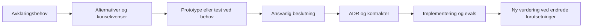

Denne siden er et arbeidsregister for arkitekturbeslutninger. Den skiller mellom førende prinsipper, planlagte funksjoner og valg som fortsatt må konkretiseres. Den beskriver ikke implementeringsstatus eller en godkjent produksjonsarkitektur. Nye forslag skal ikke behandles som vedtatte teknologivalg.

## Førende prinsipper

| Område | Førende retning |
|---|---|
| Plattform | Modulær, gjenbrukbar KI-plattform for chat, utdanning, forskning og administrasjon. Første lansering omfatter både KI-chat og kontrollert applikasjons-API; modulene utvikles og lanseres trinnvis. |
| Identitet og personvern | FEIDE/Entra ID, HVL-forvaltet identitet, pseudonymisering, dataminimering og PII-vask i Model Gateway. |
| Infrastruktur | Kubernetes med avgrensede tjenestetilganger og mikrosegmentering. |
| Lagring | PostgreSQL som standard database. S3-kompatibel objektlagring. Begge utenfor applikasjonscontainerne; ingen vedvarende lagring i sandboxer. |
| Modeller | Hybrid modelltilgang: godkjente kommersielle, nasjonale og lokalt kjørte modeller. Modellpolicy gjelder alle kall. |
| Memory Fabric | Backend er kontrollert inngang. Brukerminne prioriteres først, deretter agent- og prosjektminne. |
| Agenter | Versjonerte definisjoner, LangGraph som planlagt orkestrering, isolert praktisk utførelse ved behov. |
| Kvalitet og kontroll | Obligatoriske evals før offisiell publisering, kontrollert forbedring, menneskelig godkjenning og beskyttede revisjonsspor. |

Disse prinsippene er grunnlaget for videre arbeid. Konkrete grensesnitt, driftsvalg og godkjenninger må spesifiseres.

## Oppdatert retning 26. november 2026

LangGraph er kjernen for enkeltagenter og multiagentgrafer. Selektiv kontekstdelegering kombineres med Context on Demand mot persistent arbeidskontekst. Evalbaserte kvalitetsprofiler anvendes i uavhengig operativ kontroll; avvik går tilbake til Quality Platform og Evals. Dette er foreslått målarkitektur; kontrakter og implementeringsvalg nedenfor må fortsatt avklares.

## Første MVP og nye avklaringer

Se [leveranser og utviklingsstatus](./leveranser.mdx). Nettsøk med kildehenvisninger er et lanseringskrav. SearXNG er planlagt for metasøk; søkeleverandører, egress, SSRF-beskyttelse, prompt-injeksjon, kvalitet og vilkår må verifiseres. Gravitee.io er planlagt for API-publisering av agenter; bruk som grunnlag for Toolserver, lisens og tjenesteautentisering er åpne valg. Felles artefaktkontrakt, godkjente generative UX-komponenter, inferenskøer og kvoter må konkretiseres før berørte funksjoner lanseres.

## Avklaringer for Agent Harness

Prioriteringene nedenfor er et forslag til rekkefølge for arkitekturarbeidet, ikke en vedtatt leveranseplan. P0 betyr avklaring før berørte sikkerhets- eller kjernefunksjoner bygges ferdig; P1 betyr viktig for en sammenhengende operativ harness; P2 betyr videreutvikling.

| ID | Avklaringsbehov | Hva må besluttes | Forslag til prioritet |
|---|---|---|---|
| H01 | Agent Execution Context | Felles schema, betrodd utsteder, verifikasjon, scope, levetid og tilbakekalling. | P0 |
| H02 | Capabilities og delegering | Policy-eier, avgrensede verktøyrettigheter, subagentdelegering, godkjenninger og kontroll ved hvert kall. | P0 |
| H03 | Kontekststyring og Context on Demand | Selektiv delegering i Runtime er foreslått retning. Avklar API, tilgangsfiltrering, komprimering, søk, budsjetter og proveniens. | P0/P1 |
| H04 | Agent Workspace | Eierskap, tilstandsmodell, filer, artefakter, deloppgaver, persistens og cleanup. | P1 |
| H05 | Agent Supervisor | Hardgrenser, tidsavbrudd, avbruddssignaler, fremdriftskontroll, ressursregnskap og stoppsløyfer. | P0/P1 |
| H06 | Checkpoints og sideeffekter | State-format, idempotensnøkler, resume, tilbakekalte tilganger, avbrutte verktøykall og kompensasjon. | P1 |
| H07 | Runtime Inspector | Visning av graph, steg, traces, checkpoint, test-replay og simulering. | P2 |
| H08 | Agentdefinisjoner | Felles graph-/schemaformat for enkel agentbygger, nodeeditor, versjonering og validering. | P1 |
| H09 | Automation Platform | Planlagte kjøringer, hendelser, delegert identitet, kø, samtidighet, retry og kansellering. | P1 |
| H10 | Delegerings- og resultatkontrakt | Versjonerte oppgavepakker med mål, kontekst, ID-er, kvalitetsprofil, akseptansekriterier, output og autorisert budsjett. | P0/P1 |
| H11 | Persistent arbeidskontekst | Datamodell for samtale, melding, run, task, artefakt og snapshot; oppbevaring, sletting og kontrollert kontekst-API. | P0/P1 |
| H12 | Goal loops og Task Graph | Betingede LangGraph-overganger, avslutningsstatus og når persistent oppgavegraf/dispatcher utenfor én graf er nødvendig. | P1 |

En egen mikrotjeneste skal bare etableres når det finnes en begrunnet ansvars-, sikkerhets-, skalerings- eller livsløpsgrense. En logisk funksjon kan ligge i en eksisterende tjeneste.

## Plattform, modeller og data

| ID | Avklaringsbehov | Hva må besluttes |
|---|---|---|
| P01 | API- og hendelseskontrakter | Applikasjons-API fra første versjon: autentisering, delegert identitet, formål, agentkall, strukturerte resultater, feilkoder, versjonering, streaming, async-jobber, godkjenninger og kompatibilitet. |
| P02 | Databasetopologi | Separat PostgreSQL-instans, database eller schema per tjeneste; isolasjon, migreringer, HA, backup og restore. Ingen DB i applikasjonscontainere. |
| P03 | Objektlagring | S3-miljøer, buckets, nøkler, policy, livsløp, integritet og gjenoppretting per dataklasse. |
| P04 | Modellregister og router | Kvalitetsdata, kostnads- og kapasitetsgrenser, automatisk modellvalg, fallback og norsk syntese med Borealis som kandidat. |
| P05 | Lokal og nasjonal inferens | Maskinvare, kapasitet, tjenestetilgjengelighet, behandlingsmiljøer og godkjenning per dataklasse. |
| P06 | PII-vask | Metoder for direkte og indirekte identifikatorer, multimodale data, reversibel maskering og feilhåndtering. |
| P07 | Memory Fabric | Scopes, uttrekk og konsolidering, korrigering, sletting, proveniens og konflikthåndtering. |
| P08 | Knowledge | Direkte søk eller indeks, hybrid retrieval, embeddings, rettighetsoppdatering, kildeversjoner og autoritative samlinger. |
| P09 | Connectors og tools | OAuth/delegering, tokenforvaltning, MCP-grenser, lese-/skriverettigheter og godkjenning. |
| P10 | Skills og Agent Library | Versjonerte pakker, validering, eierskap, deling, godkjenning og eventuelle kjørbare ressurser. |
| P11 | Agentbygger | Nodeeditor, UX for enkle og avanserte agenter, felles graphformat og KI-støttet design. |

## Drift, kvalitet og etterlevelse

| ID | Avklaringsbehov | Hva må besluttes |
|---|---|---|
| D01 | Virtuelle kjøremiljøer | Kata Containers som kandidat, gVisor som alternativ med annen isolasjonsmekanisme, eventuelt egne VM-er. Trusselmodell, GUI, kapasitet og egress må testes. |
| D02 | Evalplattform | Testformat, terskler, faglig kalibrering, release gates, testisolasjon og regresjon ved modell- og kildeendringer. |
| D03 | Quality Platform | Versjonerte kvalitetsprofiler, uavhengig operativ QA, kontrollpunkter, avvikskontrakt, godkjent produksjonsevidens, regresjonstester og ansvar for godkjenning. |
| D04 | Tracing og observability | OpenTelemetry og eventuell LangSmith-bruk, databehandling, instrumentering og lagringsgrenser. |
| D05 | Audit | Hendelseskontrakt, integritet, fail-safe strategi, retention, tilgang og separat evidenslagring. |
| D06 | KI-forordningen og GDPR | Risikoklassifisering per tjeneste, tilbyder-/idriftsetterroller, relevante plikter, DPIA/ROS og dokumentasjon. |
| D07 | Produksjonsdrift | SLO-er, ressurskvoter, køer, backup/restore, beredskap, hendelseshåndtering og release-/rollback-prosess. |
| D08 | Nettverks- og tjenesteidentiteter | Tillatte forbindelser, interne identiteter, secrets, sertifikater og avgrensning mot forskningsmiljøer. |
| D09 | SILAF | Betrodd miljø- og prosjektidentitet, effektiv modellpolicy i Model Gateway, restriksjoner for verktøy, dataflyt og lagring, samt eventuell isolert utrulling. Avklares med tjenesteeier. |
| D10 | Første lansering | Kartlegg eksisterende komponentmodenhet og avhengigheter; fastsett minimumsleveranse for chat og API, integrasjonstester, driftsklarhet og kriterier for å erstatte UiO-GPT. |

## Håndtering av arkitekturbeslutninger

Arbeidsregisteret skal være en inngang til Architecture Decision Records (ADR) i prosjektets tekniske dokumentasjon. Hvert valg bør beskrive problem, relevante begrensninger, alternativer, konsekvenser for sikkerhet og personvern, testgrunnlag, ansvarlig og beslutningsstatus.

Før implementering av en berørt funksjon skal gjeldende kontrakter og beslutninger kontrolleres mot hovedrepoet. Dette offentlige registeret skal ikke inneholde interne endepunkter, hemmeligheter eller sensitive detaljer om sikkerhetsoppsettet.

Se [HVL Agent Harness](./agent-harness.mdx) for den samlede agentarkitekturen.
