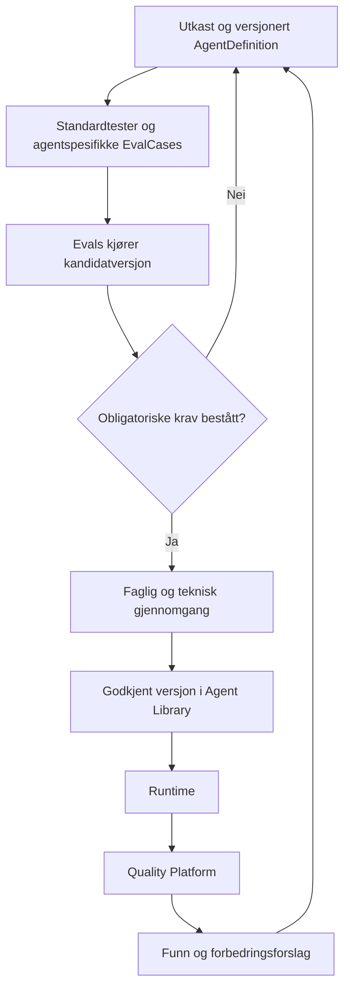
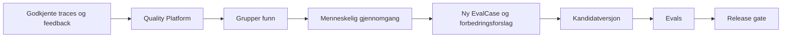

HVL skiller mellom kjøring av evalueringer og forvaltning av kvalitet gjennom agentens livsløp. Evals-tjenesten (hvl-ai-evals) kjører tester og vurderere; Quality Platform (hvl-ai-quality-platform) analyserer resultater og tillatte produksjonsepisoder, organiserer menneskelig gjennomgang, forbedringsforslag og ny evaluering. Tjenestene har egne ansvarsområder og vedvarende lagring utenfor containerne.

## Evalueringsmotor og testbibliotek

En EvalSuite kombinerer versjonerte EvalCases, input, forventet resultat eller kriterier, testdata, evalueringsmetode og terskler. En EvalRun binder resultatene til eksakt agentversjon og testversjon. Standardbiblioteket omfatter felles sikkerhets-, kvalitet- og funksjonstester. Agentbyggeren foreslår i tillegg agentspesifikke tester basert på formål, instrukser, modeller, tools, skills, knowledge, subagenter og forventet arbeidsflyt. Fagansvarlige validerer kriterier og testdata.

| Eval-område | Eksempler på vurderinger |
|---|---|
| Chat og enkeltagenter | Faglig riktighet, oppgaveoppfyllelse, kildebruk, språk, tilgjengelighet, avståelse og eskalering. |
| Knowledge og RAG | Gjenfinning, relevans, kildegrunnlag, aktualitet, tilgangsfiltrering, motstrid og svar som ikke støttes av kildene. |
| Modeller og prompts | Oppgavekvalitet, format, robusthet, bokmål/nynorsk, kostnad og responstid. |
| Tools og skills | Riktig verktøy, parameterkontrakt, feilhåndtering, tillatelser og metodens etterlevelse. |
| Multiagent og orkestrering | Overlevering, ruting, deloppgaver, sluttresultat, termineringskriterier og feilpropagering. |
| Sikkerhet og personvern | Prompt-injeksjon, datautlevering, tilgang på tvers av brukere, omgåelse av policy og PII-vask. |
| Execution Platform | Isolasjon, ressursgrenser, artefakter, korrekt kodekjøring, nettverksregler og rydding. |

Kombiner deterministiske assertions, kontrakttester, referansefasit, menneskelig vurdering og LLM-as-judge der egnet. KI-vurderere kalibreres mot faglige vurderinger; bruk gjerne flere kjøringer for å håndtere variasjon. Kritiske sikkerhetstester kan ikke erstattes av et gjennomsnittlig kvalitetspoeng. Testdata er syntetiske eller godkjente og produksjonssystemer erstattes med mocks eller avgrensede testmiljøer ved behov.

## Agentens publiseringsløp

Alle offisielle HVL-agenter skal ha obligatorisk evalueringsport før publisering. Personlige agenter følger obligatorisk grunnpolicy og passende evalueringskrav; deling eller offisiell publisering gir ikke utvidede rettigheter. Agent Registry binder godkjenning til en bestemt versjon, risikoprofil og evalrapport. Endringer som påvirker kvalitet eller risiko krever ny vurdering og relevante tester. Quality Platform kan håndtere stans, tilbakeføring og kontrollert ny publisering.

## Offline og online evaluering

Offline-evaluering kjøres mot versjonerte datasett før publisering, ved endringer og som planlagte regresjonstester. Online-evaluering kan undersøke tillatte produksjonsspor og tilbakemeldinger, med risikobasert utvalg. Ikke alle kjøringer krever en ekstra modellvurdering. Uønskede handlinger i test skal ikke treffe virkelige systemer.

Quality Platform kan trigge evals ved nye agent-, prompt-, modell-, skill-, tool- eller kildeversjoner, etter tid, ved kvalitetssvikt og etter hendelser. Automation Platform kan koordinere periodiske og hendelsesstyrte kjøringer med samme tilgangs-, budsjett- og godkjenningsregler som ordinær Runtime.

## Fra produksjonsfeil til regresjonstest

Kvalitetsarbeidet kan gjenbruke eksisterende godkjente testsett, eksempelvis fra Boost/Mime, som baseline. Fagpersoner kan gjennomgå utvalgte interaksjoner, agentepisoder eller hele multiagentkjøringer, korrigere vurderinger og gi tilbakemelding. KI kan foreslå endringer i instrukser, knowledge, skills, tools eller ruting. Forslag lagres som kandidatendringer, ikke direkte endringer av produksjonsagenten. Læring fra drift betyr her en kontrollert forbedringssløyfe, ikke automatisk trening av modellvekter.

## Logiske datakontrakter

| Objekt | Innhold |
|---|---|
| EvalCase / EvalSuite | Versjon, formål, testgrunnlag, kriterier, risiko, evaluator og terskler. |
| EvalRun / EvalResult | Kjørings-ID, kandidatversjon, testversjon, målinger, utfall, funn og evidensreferanser. |
| QualityFinding | Kategori, alvorlighet, berørt versjon, eier, status og relevante kjøringsreferanser. |
| Review / ImprovementProposal | Menneskelig vurdering, forslag, endringsgrunnlag og godkjenningsstatus. |
| ReleaseDecision | Agentversjon, testresultater, ansvarlig godkjenner, tidspunkt og eventuelle avgrensninger. |

Spor modell og versjon, graph, instrukser, knowledge-indeks/kildeversjon, skills, tools og policy der det er nødvendig for etterprøvbarhet. Evalplattformen leser kun tillatt evidens via kontrollerte grensesnitt; logger og audit forblir separate. Eval-kall til modeller går gjennom Model Gateway. LangSmith er en aktuell løsning for tracing, datasett, eksperimenter og evaluering, under HVLs krav til behandling, drift og tilgang; HVL beholder egne kontroll- og godkjenningsdata.

Se [Audit, tracing og KI-forordningen](./sporbarhet.mdx).
