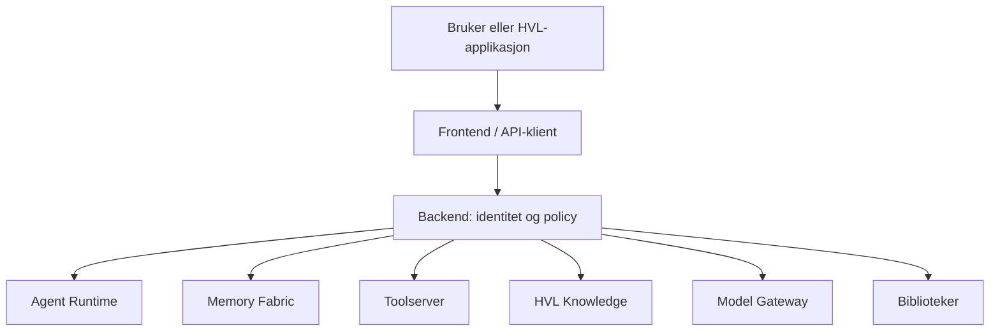

**Læringsmål:** Forstå grensen mellom brukergrensesnitt, backend og spesialiserte tjenester.

HVLs KI-økosystem er en planlagt felles plattform for studenter og ansatte. Chat er én inngang; Canvas, HVL Skjema og andre applikasjoner skal også kunne bruke de samme tjenestene. Dette kurset beskriver målarkitekturen, ikke verifisert implementeringsstatus.

## Frontend

Frontend viser samtaler, strømmede svar, vedlegg, prosjekter, agentbygger, biblioteker og godkjenningsdialoger. Den håndterer brukerinteraksjon, ikke privilegerte modellnøkler, databaseforbindelser eller direkte tilgang til interne systemer.

## Backend

Backend håndterer autentisering (FEIDE/Entra ID), autorisasjon, samtaler og meldinger, orkestrering, policy, tjenestekall og relevante logger. Backend verifiserer forespørsler; en klientoppgitt bruker-ID er ikke tilstrekkelig. Komponentene skal ha avgrensede ansvar.

**Eksempel:** En prosjektleder ber om en oppsummering. Backend kontrollerer tilgang, innhenter relevant kontekst og returnerer modellens svar. Ingen av de andre tjenestene behøver å være direkte eksponert mot nettleseren.

import Quiz from '@site/src/components/Quiz';

<Quiz question={"Hvor håndheves privilegerte tilgangsregler?"} options={["I nettleseren alene","I backend og ansvarlige tjenester","I modellens systemprompt"]} correct={1} explanation={"Klienten og modellen er ikke sikkerhetsgrenser."} />
