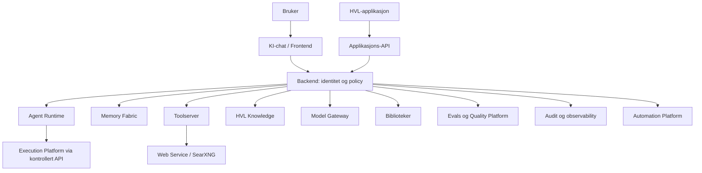
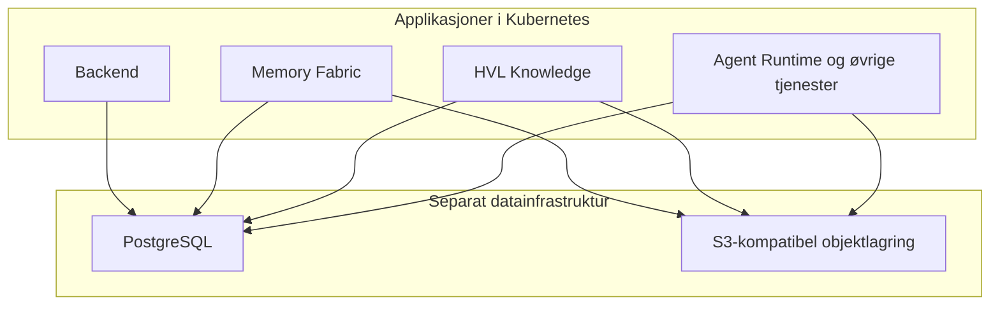

**Formål:** Forstå grensen mellom brukergrensesnitt, backend og spesialiserte tjenester.

HVLs KI-økosystem er en felles plattform under utvikling. Målarkitekturen er designet, og utviklingsarbeid er gjennomført, men komponentenes faktiske modenhet og integrasjonsstatus må verifiseres mot hovedrepoet. Første godkjente lansering skal ha både KI-chat for studenter og ansatte og et kontrollert API for HVL-applikasjoner. Ambisjonen er å erstatte UiO-GPT som grunnleggende KI-chat når tjenesten er driftsklar. Utvikling og leveranser skjer modulært og trinnvis.

Se [leveranseomfang og rapportert utviklingsstatus](./leveranser.mdx) for første MVP, videre prioriteringer og tekniske avklaringer. Nettsøk med kildehenvisninger er et lanseringskrav.

## Gjenbruk av åpen kildekode

LangGraph er allerede tatt i bruk i utviklingsarbeidet og er orkestreringsmotoren i målarkitekturen. Gjenbruk av etablerte komponenter skal prioriteres der det er egnet. Før innføring vurderes sikkerhet, lisens, vedlikehold, avhengigheter, driftsbehov og kompatibilitet med HVLs infrastruktur. Valg dokumenteres og testes; gjenbruk erstatter ikke integrasjonstesting og produksjonsgodkjenning. Se [åpne arkitekturvalg](./arkitekturavklaringer.mdx) og [strategisk beslutningsgrunnlag](../prodekanforum/intro.mdx).

## Frontend

Frontend viser samtaler, strømmede svar, vedlegg, prosjekter, agentbygger, biblioteker og godkjenningsdialoger. Den håndterer brukerinteraksjon, ikke privilegerte modellnøkler, databaseforbindelser eller direkte tilgang til interne systemer.

## Applikasjons-API

Canvas-utvidelser (eksempelvis LTI), HVL Skjema, saksbehandlingsapplikasjoner og andre HVL-tjenester skal kunne kalle plattformen uten å bruke chatgrensesnittet. Backend er den kontrollerte inngangen for applikasjonskall, inkludert oppstart av agentkjøringer og mottak av strukturerte resultater. Bruker- og tjenesteidentitet, formål, tilgang, miljøkontekst og agentversjon må valideres på serversiden. Integrasjoner skal ikke få direkte tilgang til interne plattformtjenester eller lagring.

Kontrakter for synkrone og asynkrone operasjoner, strømming, status, avbrudd, resultat og godkjenning må konkretiseres. Det er API-et som inngår i første leveranse, ikke nødvendigvis alle eksempelapplikasjonene.

Agent Registry beholder eierskap til Agent ID, versjoner, schema og publiseringsstatus. En agent kan publiseres til chat, API eller begge. Gravitee.io er planlagt som API-forvaltningslag for registrering, tilgang, abonnement og kvoter; integrasjon og lisens avklares. Generelt applikasjons-API inngår i første MVP, mens selvbetjent API-publisering av agenter planlegges ved lansering eller i neste delleveranse. Backend håndhever alltid agentens effektive rettigheter og validerer input og output.

## Backend

Backend håndterer autentisering (FEIDE/Entra ID), autorisasjon, samtaler og meldinger, orkestrering, policy, tjenestekall og relevante logger. Backend verifiserer forespørsler; en klientoppgitt bruker-ID er ikke tilstrekkelig. Komponentene skal ha avgrensede ansvar. Innebygd personvern er et grunnprinsipp: brukeridentitet og tilgang håndteres av HVL, mens modellene får en avgrenset kontekst uten direkte identitetsmetadata. Se kapitlet [Innebygd personvern](./personvern.mdx).

**Eksempel:** En prosjektleder ber om en oppsummering. Backend kontrollerer tilgang, innhenter relevant kontekst og returnerer modellens svar. Ingen av de andre tjenestene behøver å være direkte eksponert mot nettleseren.

Plattformens kontroll- og kvalitetslag omfatter [Evals og Quality Platform](./evaluering.mdx), [Execution Platform](./kjoremiljo.mdx) og [Audit og tracing](./sporbarhet.mdx). Diagrammet viser logiske funksjoner, ikke alle nettverksforbindelser.

## Miljøavhengig sikkerhet

I SILAF skal KI-chat og applikasjoner kunne tilbys med en særskilt sikkerhetsprofil. Betrodd miljø- og prosjektkontekst følger hele kjøringen, inkludert underagenter. Model Gateway håndhever modellrestriksjoner, mens øvrige tjenester håndhever begrensninger på kontekst, verktøy, kommunikasjon, lagring og utførelse. Ingen komponent kan utvide effektive rettigheter. Se [Model Gateway](./modeller.mdx). Konkret utrulling og sikkerhetsprofil krever egen avklaring og godkjenning.

## Felles krav til database og lagring

PostgreSQL er standard database for hele KI-økosystemet. S3-kompatibel objektlagring brukes til filer, vedlegg, dokumentkopier og andre objekter som skal bevares. Begge leveres som separate infrastrukturtjenester utenfor applikasjonscontainerne. Database og objektlager skal ikke pakkes inn i tjenestenes container-images eller følge med som lokale lagringstjenester i produksjonsdeployments.

Applikasjonscontainerne skal kunne erstattes, restartes og skaleres uten tap av vedvarende data. Lokale filer i containerne brukes bare til midlertidig arbeid, aldri som autoritativ lagring. Agentenes isolerte arbeidsmiljøer følger samme prinsipp.

Diagrammet viser lagringsprinsippet, ikke en felles database eller bøtte som alle tjenester får tilgang til. Hver tjeneste eier sine data og har egne avgrensede database- og objektlagringstilganger. Andre tjenester bruker eierens API, ikke direkte oppslag i fremmede tabeller. Forbindelser, autentisering, kryptering, sikkerhetskopiering, gjenoppretting og migrering må håndteres uavhengig av applikasjonscontainerens livsløp. Fysisk inndeling i PostgreSQL-instanser og S3-miljøer bestemmes av sikkerhet, dataklassifisering og driftsbehov.

For en samlet gjennomgang av agentenes operative arkitektur, se [HVL Agent Harness](./agent-harness.mdx). [Åpne arkitekturvalg og avklaringsbehov](./arkitekturavklaringer.mdx) skiller førende prinsipper fra funksjoner og teknologivalg som må konkretiseres.
