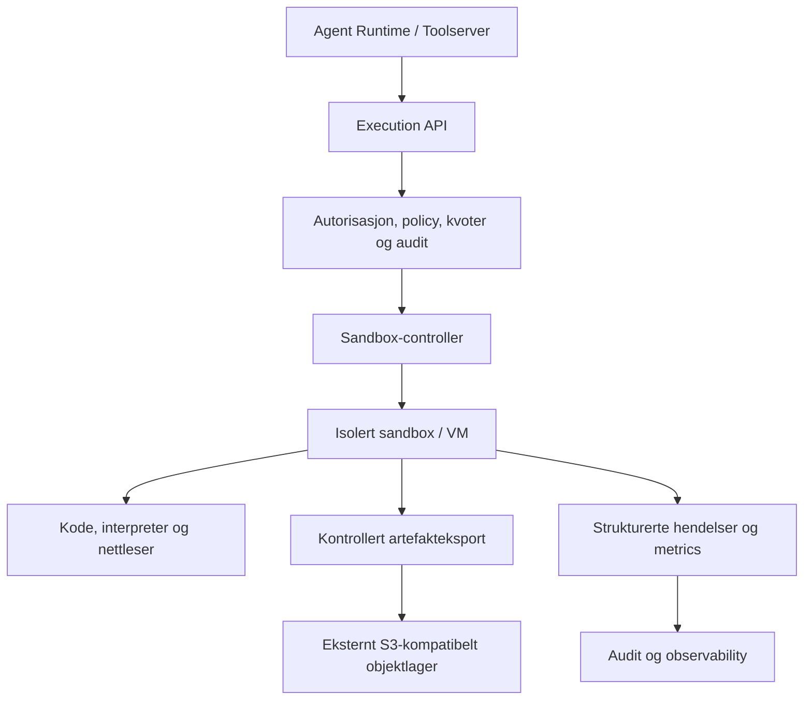
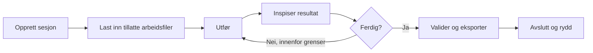

Agent Runtime (LangGraph) orkestrerer arbeidsflyt, tilstand og modell- og verktøykall. Execution Platform (hvl-ai-execution-platform) tilbyr en separat tjeneste for isolert utførelse av kode, filbearbeiding og Computer Use. Den kan gi agenten et disponibelt, VM-lignende arbeidsmiljø med terminal, interpreter, nettleser og ved behov grafisk brukerflate. En ordinær modellforespørsel trenger ikke en egen VM.

## Logisk arkitektur

Execution API validerer identitet, run context, dataklasse, capability, budsjett og sesjonseierskap. Runtime får ikke administrativ tilgang til Kubernetes eller hypervisoren. Et separat API-image håndterer kontrollplanet; sandbox-image inneholder godkjent arbeidsmiljø. Kubernetes Pods/Jobs med en dedikert RuntimeClass og eventuelt egne virtuelle maskiner brukes etter isolasjonsbehov. Kata Containers med VM-basert isolasjon er en foretrukket kandidat; gVisor er et alternativ med annen isolasjonsmekanisme og er ikke det samme som en VM. Valg av runtime avhenger av trusselmodell, GPU-/GUI-behov og kapasitet.

## Kjøremoduser

| Modus | Bruk |
|---|---|
| Innebygde verktøy | Avgrensede funksjoner som ikke trenger sandbox. |
| Micro-exec | Kortvarig kjøring av kode i disponibelt miljø. |
| Interpreter-session | Eksklusiv sesjon med filer og tilstand under en oppgave. |
| Computer Use | Nettleser eller skrivebord med avgrensede domener, handlinger og arbeidsfiler. |
| Heavy jobs | Større asynkrone jobber med egne ressursgrenser, avbrudd og status. |

En liten varm pool kan redusere oppstartstid. Hver sandbox tildeles eksklusivt til en sesjon og slettes eller tilbakestilles sikkert etterpå. En permanent delt Python-prosess eller et felles filsystem på tvers av brukere er ikke isolasjonsmodellen.

## Sesjon og utførelse

En execution session knyttes til en autorisert kjøring. Agenten kan generere kode, kjøre den, inspisere stdout/stderr og artefakter, rette feil og prøve igjen innenfor begrensninger. Computer Use kan tilsvarende observere arbeidsflaten og utføre tillatte handlinger; irreversible eller vesentlige handlinger krever kontroll og eventuell menneskelig godkjenning.

## Sikkerhetsgrenser

- Dedikerte namespaces/node pools ved behov; standard nekt for nettverk og eksplisitt tillatt egress via kontrollerte proxyer.
- Ingen direkte tilgang til internnett, metadataendepunkter, container-runtime-socket, cluster-admin eller brukerens autentiseringstokens.
- Minste privilegium, ikke-root der mulig, ingen uautoriserte host mounts, godkjente images og avgrensede fil-/pakkeoperasjoner.
- CPU-, minne-, disk-, tids-, prosess-, nettverks- og kostnadsgrenser; automatisk TTL, avbrudd og sikker rydding også ved feil.
- Arbeidsfiler hentes via autoriserte, kortlivede grensesnitt. Artefakter valideres, skannes der relevant og eksporteres til tilgangsstyrt, ekstern S3-kompatibel objektlagring i godkjent miljø.
- Innhold fra nettsider, filer og skjermbilder er potensielt upålitelige data. Prompt-injeksjon skal ikke kunne utvide nettverkstilgang eller verktøyrettigheter.
- Fagsystemoperasjoner går via godkjent Toolserver/connector; ingen gjenbruk av brukerens åpne nettlesersesjon som generell adgang. Eventuelle spesifikke nettleserintegrasjoner må håndtere autentisering og hemmeligheter særskilt.

Data med særskilte krav, som beskyttede forskningsdata, må behandles i et miljø godkjent for den dataklassen. Ingen automatisk kopiering til den generelle sandbox-poolen.

## Logiske kontrakter

ExecutionSession beskriver sessionId, runId, eier/scope, miljøprofil, ressursbudsjett, status og utløp. ExecutionRun beskriver executionId, sessionId, type, status, tidspunkt, ressursbruk, resultat og artefaktreferanser. Agent Runtime håndterer checkpoints, idempotens, tidsavbrudd og resume der arbeidsflyten tillater det. Langvarige jobber rapporterer status asynkront.

Strukturerte hendelser korreleres med executionId, sessionId, runId, requestId og eventuelt threadId, uten å logge rått sensitivt innhold som standard. Kontrollplanet og sandboxen har separate tillatelser. Execution Platform skal kunne testes for isolasjon, egress, rydding, samtidighet og artefaktintegritet gjennom Evals.

Se [Audit, tracing og KI-forordningen](./sporbarhet.mdx).

Execution Platform og Agent Runtime bruker ekstern PostgreSQL for vedvarende sesjonsmetadata, jobbstatus og checkpoints der det er nødvendig, og ekstern S3-kompatibel objektlagring for godkjente artefakter. Sandboxens lokale filsystem er midlertidig. Sandboxen får ikke direkte tilgang til databasen eller generelle S3-nøkler.
