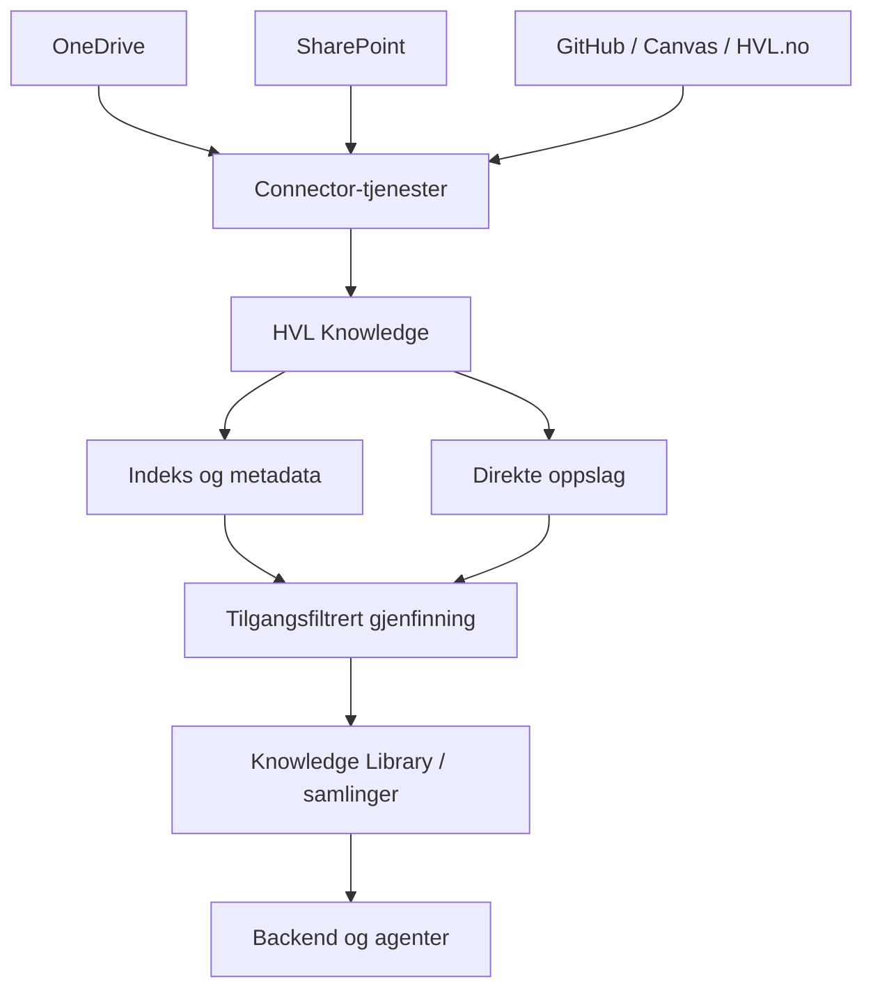
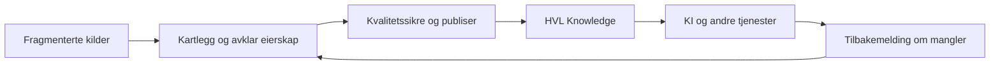

HVL Knowledge skal gi KI kontrollert tilgang til kunnskap fra eksisterende systemer. Dokumenter trenger ikke flyttes fra autoritative kilder. RAG henter relevant informasjon til modellkonteksten uten å endre modellvektene.

## Connectors og samlinger

Personlige connectors (f.eks. OneDrive) gir brukeren tilgang til valgte egne kilder. Avdelingsvise connectors (f.eks. SharePoint) forvaltes av autoriserte eiere. Prosjekt- og emnekilder kan omfatte GitHub og Canvas; institusjonelle kilder kan være kvalitetssystem, regelverk og HVL.no. Google Drive og andre systemer kan vurderes ved behov.

Knowledge Collections er foreslåtte gjenbrukbare samlinger av kilder. Agentbyggeren skal kunne velge slike samlinger uten å kopiere dokumenter eller rettigheter.

Direkte oppslag gir fersk informasjon; indeksering kan gi effektiv semantisk gjenfinning, men krever synkronisering, sletting, tilgangsfiltrering og sikker håndtering av dokumentkopier og embeddings. Hybrid søk kombinerer disse. Kilder må følge resultatene som referanser. Tilbakekalte rettigheter skal slå gjennom før utlevering.

## Forvaltede informasjonskilder

På sikt skal HVL Knowledge tilby forvaltede kilder med definert eier, forvalter, autoritativ original, klassifisering, tilgang, gyldighet, versjon, synkronisering, kvalitetssikring og oversikt over bruk. Knowledge Library blir katalogen over disse. Eksempler: HR-rutiner, eksamensregelverk, IT-veiledninger, økonomi, forskning, pedagogikk og kvalitetssystem. Faktiske kildeeiere må avklares organisatorisk.

Ved konflikt mellom gammel personlig kopi og gjeldende autoritativ rutine må systemet prioritere korrekt gyldighetsområde, synliggjøre motstrid og ikke la KI alene erklære dokumenter som gjeldende.

## Informasjonsforvaltning som mulighet

HVL har etter prosjektets situasjonsbeskrivelse ikke en felles struktur for lagring og deling av rutinebeskrivelser og organisatorisk kunnskap. Informasjonen er fragmentert; eierskap, aktualitet og versjoner kan være uklare. Dette er ikke først og fremst et KI-problem.

KI-økosystemet kan gi et konkret insentiv til å kartlegge kilder, finne gjeldende rutiner, avdekke dokumentasjonshull, tildele ansvar og rydde opp i motstridende informasjon.

HVL Knowledge bør gradvis støtte kilderegister, metadata, duplikat- og konfliktdeteksjon, aktualitetskontroll, godkjenningsflyt og kunnskapshull. KI kan foreslå; kildeeier avgjør. Plattformen skal ikke erstatte arkiv, SharePoint eller fagsystemenes autoritative funksjoner.

Faseforslag: dokumenter og RAG; personlige connectors; delte avdelingskilder; forvaltet katalog; autoritet og kvalitetskontroll. Datamodell og tilgangsarkitektur må ta høyde for framtidige scopes allerede tidlig.

import Quiz from '@site/src/components/Quiz';

<Quiz question={"Kan en delt agent automatisk lese eierens OneDrive?"} options={["Ja","Nei, tilgang må kontrolleres for den som bruker agenten","Ja, hvis agenten er publisert"]} correct={1} explanation={"Agentdeling er ikke det samme som kildedeling."} />
