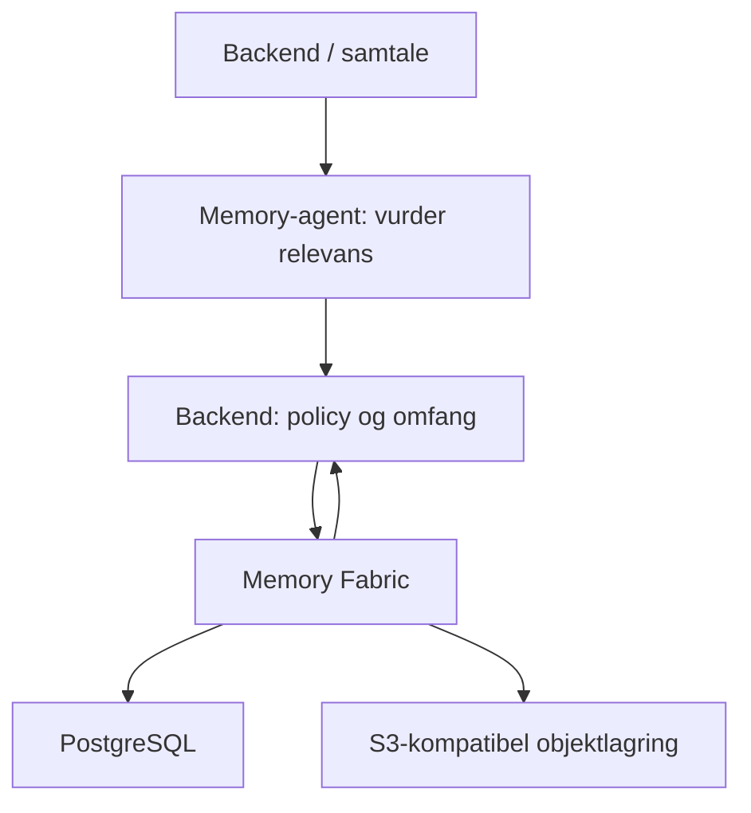

Memory Fabric gir varig, kontrollert kontekst utover modellens kontekstvindu. Samtalehistorikk, midlertidig runtime-tilstand og varig minne må skilles.

| Område | Formål |
|---|---|
| Bruker | Preferanser og relevant kontekst |
| Agent | Oppgavespesifikk kontekst mellom kjøringer |
| Prosjekt | Beslutninger og fremdrift |
| Arbeidsminne | Midlertidig tilstand under kjøring |

Brukerminne prioriteres først i MVP. Agent- og prosjektminne er videreutvikling. Arbeidsminne kan ligge i Runtime og trenger ikke lagres varig i Fabric.

PostgreSQL er sentral database, med S3-kompatibel objektlagring der det er hensiktsmessig. Vedvarende lagring ligger utenfor applikasjonscontainerne. Memory Fabric skal nås via backend i det planlagte isolerte nettverket. Bruker, scope, proveniens, gyldighet, tilgang, sletting og korrigering må inngå i designet. Minne kan inneholde feil og må ikke gis autoritet over verifiserte kilder.

Minne og historikk forvaltes innenfor HVLs godkjente behandlingsmiljø. Eksterne modeller får bare nødvendig, policykontrollert kontekst, ikke direkte tilgang til minnelageret eller hele brukerprofilen. Pseudonymiserte data er fortsatt personopplysninger der de kan knyttes til en person.
