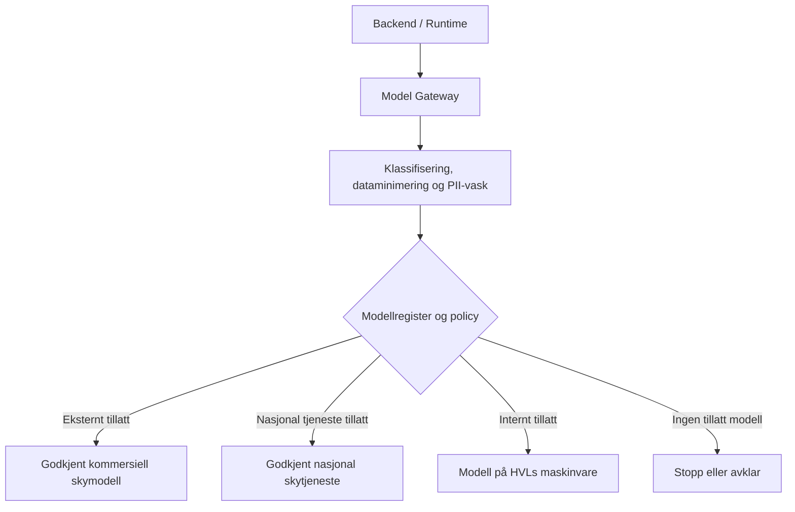
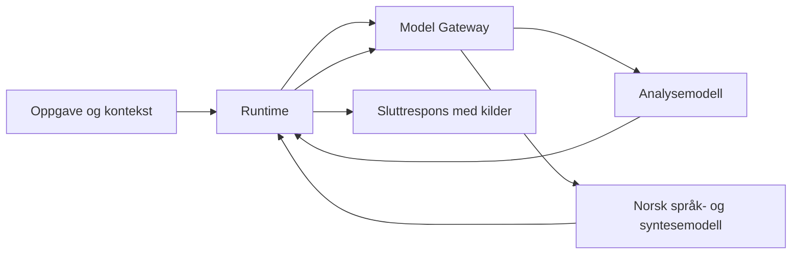

En LLM tolker og genererer språk, men har ikke automatisk kunnskap om HVLs interne data. Model Gateway er plattformens felles grensesnitt mot godkjente KI-modeller og forvalter registeret over tilgjengelige modeller på tvers av leverandører og behandlingsmiljøer.

## Modellregister

Registeret omfatter kommersielle skymodeller, modeller på HVLs egen maskinvare og modeller via nasjonale skytjenester. Hver modelloppføring beskriver modell og versjon, leverandør, behandlingsmiljø, godkjente dataklasser og bruksformål, modaliteter, kontekstvindu, språkegenskaper, kostnad, kapasitet og tilgjengelighet. Brukere og agenter får bare velge modeller som er tillatt for den aktuelle behandlingen.

## Manuelt og automatisk modellvalg

Brukeren kan velge modell eksplisitt. Agentbyggeren kan foreslå modell, modellroller og ressursgrenser basert på agentens oppgave. Backend og Runtime kan også be om automatisk valg etter oppgave og krav til kvalitet, språk, kapasitet, pris og responstid. Model Gateway håndhever policy uavhengig av hvordan modellvalget ble gjort.

HVL håndterer brukeridentiteten internt. Model Gateway skal ikke sende direkte identitetsmetadata til eksterne modelltilbydere. Gatewayens PII-vaskemaskin skal redusere identifiserende opplysninger i prompt og kontekst der det er mulig. Den er ett av flere sikkerhetslag, ikke en garanti for anonymisering. Se [Innebygd personvern](./personvern.mdx).

Policy gjelder også embeddings, multimodale modeller, hjelpe- og reserve-modeller. Dataklassifisering og behandlingsmiljø må vurderes for hvert modellkall; et automatisk modellbytte skal aldri omgå disse reglene.

## Sikkerhetsprofil for SILAF

Model Gateway skal håndheve miljø- og prosjektspesifikke modellrestriksjoner for kjøringer i SILAF. En betrodd tjeneste må etablere miljøidentitet og autorisert prosjektkontekst på serversiden; en klientoppgitt SILAF-markør, IP-adresse eller modellens egne vurderinger er ikke tilstrekkelig autorisasjon. Gateway beregner effektivt modellutvalg som snittet av tillatte modeller for miljøet, prosjektet, dataklassen og det aktuelle formålet. Samme begrensning gjelder modellregisteret som presenteres i brukergrensesnittet og hvert faktiske modellkall, inkludert subagenter, embeddings, evaluering, syntese og fallback. Manglende eller ugyldig sikkerhetskontekst skal ikke gi tilgang til en mindre restriktiv modell; kjøringen må avvises eller avklares.

Toolserver, Knowledge, Memory Fabric, Execution Platform og øvrige tjenester må håndheve tilsvarende begrensninger for egne operasjoner, lagring og utgående kommunikasjon. Modellvalg alene hindrer ikke dataflyt ut av forskningsmiljøet. Der forskningsdata må forbli innenfor en særskilt behandlingsgrense, vurderes isolert utrulling av nødvendige plattformkomponenter. Eksakt identitetskontrakt, tillatte modellendepunkter, nettverksgrenser og datalagring avklares med tjenesteeier før godkjenning. Dette er planlagt funksjonalitet, ikke dokumentert implementering.

## Flere modeller i én arbeidsflyt

Runtime kan koordinere forskjellige modellroller, eksempelvis en modell for kompleks analyse og en annen for språklig syntese av sluttresponsen. Nasjonalbibliotekets åpne [Borealis-modellserie](https://ai.nb.no/borealis/) er en aktuell kandidat til norsk responsgenerering på bokmål og nynorsk. Modellen må evalueres for oppgaven, og syntesesteget må bevare fakta, kildehenvisninger og faglige nyanser.

Modellregisteret og det felles grensesnittet gir mulighet for å introdusere nye modeller uten å omskrive agentene og applikasjonene som bruker plattformen.
