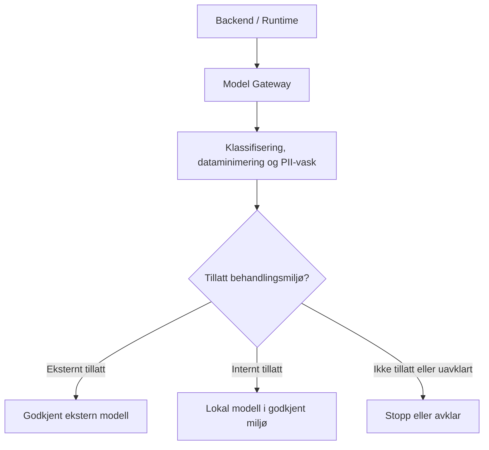

En LLM tolker og genererer språk, men har ikke automatisk kunnskap om HVLs interne data. Model Gateway gir et felles grensesnitt mot godkjente lokale og eksterne modeller.

HVL håndterer brukeridentiteten internt. Model Gateway skal ikke sende direkte identitetsmetadata til eksterne modelltilbydere. Gatewayens PII-vaskemaskin skal redusere identifiserende opplysninger i prompt og kontekst der det er mulig. Den er ett av flere sikkerhetslag, ikke en garanti for anonymisering. Se [Innebygd personvern](./personvern.mdx).

Modellvalg avhenger av dataklassifisering, oppgave, kapasitet, kostnad, responstid og språk. Policy må også gjelde embeddings, hjelpe- og reserve-modeller. Lokal drift er ikke i seg selv en godkjenning for røde eller svarte data.

Agentbyggeren bør analysere oppgaven og foreslå modell og ressursgrenser. En framtidig språk- og syntesemodell kan formulere sluttresultatet uten at den nødvendigvis utfører hovedanalysen. Dette er et designalternativ, ikke et fast krav.
