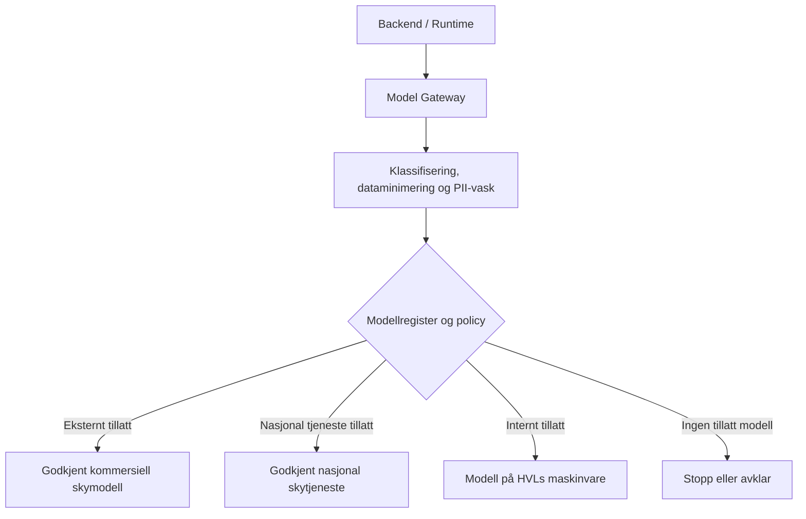
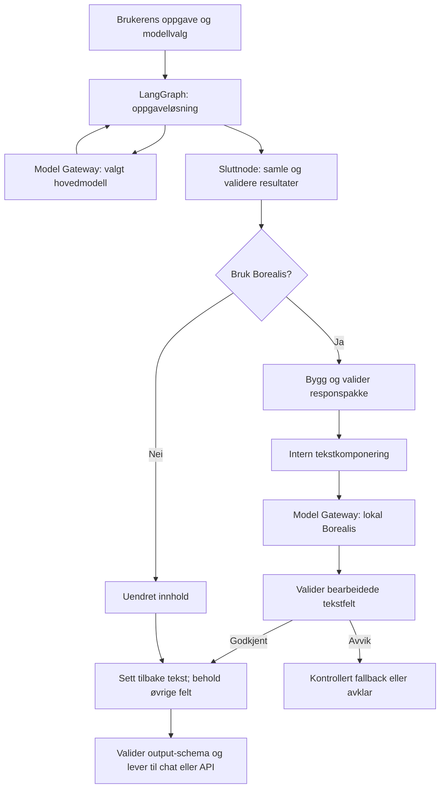

En LLM tolker og genererer språk, men har ikke automatisk kunnskap om HVLs interne data. Model Gateway er plattformens felles grensesnitt mot godkjente KI-modeller og forvalter registeret over tilgjengelige modeller på tvers av leverandører og behandlingsmiljøer.

## Modellregister

Registeret omfatter kommersielle skymodeller, modeller på HVLs egen maskinvare og modeller via nasjonale skytjenester. Hver modelloppføring beskriver modell og versjon, leverandør, behandlingsmiljø, godkjente dataklasser og bruksformål, modaliteter, kontekstvindu, språkegenskaper, kostnad, kapasitet og tilgjengelighet. Brukere og agenter får bare velge modeller som er tillatt for den aktuelle behandlingen.

## Model Gateway MVP

Første versjon avgrenses til modellregister med godkjent modellutvalg, manuelt modellvalg, leverandøradaptere med felles kallgrensesnitt, serverside policy og relevante logger. Avansert automatisk ruting og kostnadsoptimalisering kan komme senere. Gateway håndterer modellkall; LangGraph i Agent Runtime eier arbeidsflyten og bestemmer når de ulike modellrollene benyttes.

## Lokal inferens og ressursstyring

Fire Dell GB10-maskiner er anskaffet til utvikling, testing og gradvis produksjon i Kubernetes. Planlagt hybridmodell omfatter også godkjente Azure Foundry-modeller i egnet behandlingsmiljø og eventuell nasjonal kapasitet (tilgang til NTNU-datasenteret er ikke avklart). Lokal inferens får kø, prioritet, kvoter og kapasitetsstyring; interaktive kall prioriteres foran batchjobber, som kjøres ved ledig kapasitet. Lyd-, bilde- og eventuell videogenerering kan få egne kvoter. Sammenkobling av to GB10-maskiner vurderes ved behov, avhengig av kompatibilitet og målt ytelse. Lokal kjøring eller EØS-region alene gir ikke godkjenning for en dataklasse.

## Manuelt og automatisk modellvalg

Brukeren kan velge modell eksplisitt. Agentbyggeren kan foreslå modell, modellroller og ressursgrenser basert på agentens oppgave. Backend og Runtime kan også be om automatisk valg etter oppgave og krav til kvalitet, språk, kapasitet, pris og responstid. Model Gateway håndhever policy uavhengig av hvordan modellvalget ble gjort.



HVL håndterer brukeridentiteten internt. Model Gateway skal ikke sende direkte identitetsmetadata til eksterne modelltilbydere. Gatewayens PII-vaskemaskin skal redusere identifiserende opplysninger i prompt og kontekst der det er mulig. Den er ett av flere sikkerhetslag, ikke en garanti for anonymisering. Se [Innebygd personvern](./personvern.mdx).

Policy gjelder også embeddings, multimodale modeller, hjelpe- og reserve-modeller. Dataklassifisering og behandlingsmiljø må vurderes for hvert modellkall; et automatisk modellbytte skal aldri omgå disse reglene.

## Sikkerhetsprofil for SILAF

Model Gateway skal håndheve miljø- og prosjektspesifikke modellrestriksjoner for kjøringer i SILAF. En betrodd tjeneste må etablere miljøidentitet og autorisert prosjektkontekst på serversiden; en klientoppgitt SILAF-markør, IP-adresse eller modellens egne vurderinger er ikke tilstrekkelig autorisasjon. Gateway beregner effektivt modellutvalg som snittet av tillatte modeller for miljøet, prosjektet, dataklassen og det aktuelle formålet. Samme begrensning gjelder modellregisteret som presenteres i brukergrensesnittet og hvert faktiske modellkall, inkludert subagenter, embeddings, evaluering, syntese og fallback. Manglende eller ugyldig sikkerhetskontekst skal ikke gi tilgang til en mindre restriktiv modell; kjøringen må avvises eller avklares.

Toolserver, Knowledge, Memory Fabric, Execution Platform og øvrige tjenester må håndheve tilsvarende begrensninger for egne operasjoner, lagring og utgående kommunikasjon. Modellvalg alene hindrer ikke dataflyt ut av forskningsmiljøet. Der forskningsdata må forbli innenfor en særskilt behandlingsgrense, vurderes isolert utrulling av nødvendige plattformkomponenter. Eksakt identitetskontrakt, tillatte modellendepunkter, nettverksgrenser og datalagring avklares med tjenesteeier før godkjenning. Dette er planlagt funksjonalitet, ikke dokumentert implementering.

## Flere modeller i én arbeidsflyt: Response Composer i LangGraph

Første iterasjon kan tilby tre kjøremåter: direkte svar fra valgt modell, kombinert kjøring med en egen norsk responsmodell, og helt lokal kjøring med godkjente lokale modeller. Brukeren kan velge kombinert kjøring og ønsket målform. Nasjonalbibliotekets [Borealis-modellserie](https://ai.nb.no/borealis/) er foreslått som lokal Response Composer. Borealis 2 26B-A4B er prioritert kandidat, med én av HVLs fire GB10-maskiner dedikert til tjenesten i første utrulling. Modellversjon, lisens, inferensstøtte, kvalitet og faktisk kapasitet verifiseres før produksjon. Den opprinnelige Borealis 12B eller 27B kan vurderes som reserve dersom den nye varianten ikke møter kravene.

LangGraph koordinerer arbeidsflyten. Hovedmodellen løser oppgaven, eventuelt med tools og RAG. Deretter bygger Runtime en strukturert responspakke av grafens tilstand og autoriserte kildereferanser. En valgfri intern Response Composer-operasjon i sluttnoden kaller Borealis via Model Gateway. Borealis formulerer utvalgte tekstfelt på bokmål eller nynorsk, uten å overta hovedmodellens oppgave eller verktøytilganger. Det er ikke en egen synlig node i React Flow i MVP-en.



### Sluttnodens konfigurasjon og ansvarsdeling

I MVP-en vises én avkrysningsboks i sluttnodens konfigurasjonsskjema: «Bruk Nasjonalbibliotekets Borealis». Når den er valgt, vises et obligatorisk nedtrekksfelt med Bokmål og Nynorsk. Innstillingene lagres i den versjonerte agentdefinisjonen, eksempelvis `responseComposer.enabled` og `responseComposer.locale` (illustrative feltnavn). Backend validerer konfigurasjonen og kompilerer den til sluttnodens interne LangGraph-arbeidsflyt. Avkrysning er av som standard; ingen ekstra synlig node er nødvendig. Senere kan komponering tilbys etter enkelte agentnoder eller som eksplisitt nodetype dersom det er nyttig.

I multiagentgrafer utveksles strukturerte delresultater mellom agentene uten språklig omskriving som standard. Sluttnoden samler relevante resultater, kilder, verktøyresultater, forbehold og artefaktreferanser fra autorisert grafstate og persistent arbeidskontekst. Runtime velger ut nødvendig kontekst innenfor modellens kontekstvindu og oppretter responspakken.

Sluttnoden er uavhengig av publiseringskanalen. For både chat og API beholdes opprinnelig responsstruktur. I API-agenter angir agentens output-kontrakt eksplisitt hvilke fritekstfelt som kan språkbehandles, eksempelvis gjennom godkjente feltstier. Borealis får bare nødvendige tekstdata og relevante kilde- og artefaktreferanser. Den får ikke i oppgave å bearbeide eller generere bilder, dokumenter, regneark, kode, diagrammer eller generative UI-komponenter på nytt. Tallfelt, ID-er, filreferanser, struktur og ikke-valgte felt skal videreføres uendret. Runtime setter bearbeidede tekstfelt tilbake i responsen og validerer output-schema; chat kan deretter rendere tekst, kilder og artefakter, mens API returnerer den avtalte strukturen.

**Borealis komponerer språket. Sluttnoden komponerer den komplette responsen.** Ved strukturert JSON-output kan inferensserverens schema-begrensning benyttes hvis modellen og serveren støtter dette; Runtime validerer uansett resultatet. Ved feil brukes en policygodkjent fallback eller en eksplisitt feilhåndtering, ikke en umerket endring av API-kontrakten.

### Foreslått strukturert responspakke

Runtime bygger en versjonert JSON-kontrakt. Den inneholder brukerens spørsmål, resultat og dokumenterbare konklusjoner fra hovedmodellen, autoriserte kilde-ID-er med referanser og relevante utdrag, usikkerhet, faglige forbehold, språk og presentasjonsformat samt eventuelle artefaktreferanser. Eksempel (illustrativt, ikke fastsatt API-schema):

```json
{
  "schema_version": "0.1",
  "question": "Hva viser analysen?",
  "locale": "nn-NO",
  "format": "markdown",
  "text_fields": ["/answer"],
  "answer": "Resultatet gjelder bare det undersøkte materialet.",
  "findings": [
    {
      "text": "Resultatet er avgrenset til det undersøkte materialet.",
      "source_ids": ["s1"]
    }
  ],
  "sources": [
    {
      "id": "s1",
      "title": "Eksempeldokument",
      "ref": "source:example",
      "excerpt": "Analysen omfattar berre det undersøkte materialet."
    }
  ],
  "caveats": ["Ingen generalisering utover materialet."],
  "artifacts": []
}
```

Kilderegister og artefaktreferanser forvaltes av Runtime, ikke av responsmodellen. Kildeinnhold behandles som data, ikke instruksjoner. JSON valideres før komponering. Response Composer skal bevare fakta, tall, forbehold og faglige nyanser, ikke introdusere nye påstander eller oppdiktede kilder. Runtime kontrollerer referanse-ID-er og rendrer lenker fra autoritative metadata. Slik validering sikrer ikke alene at påstandene er faglig underbygget; evals må også måle semantisk trofasthet, språkkvalitet på bokmål og nynorsk, kildegrunnlag og responstid. Ved feil kan Runtime bruke en allerede godkjent direkte respons eller avstå og forklare begrensningen; fallback må aldri omgå modellpolicy. Direkte streaming bør ikke vise hovedmodellens råutkast som endelig svar når komponering er valgt.

Dette er en avgrenset, valgfri MVP-funksjon, ikke et krav om at alle svar skal gå gjennom Borealis. Lokal komponering gjør ikke et tidligere eksternt modellkall lokalt. Ved helt lokal kjøring må også embeddings, hjelpe- og reservekall samt relevante tools følge den lokale behandlingspolicyen.

### Lokal drift av Borealis-tjenesten

Planlagt første oppsett er én dedikert Dell GB10-maskin i Kubernetes. Borealis 2 26B-A4B prioriteres for utprøving, med omtrent 26 milliarder totale og fire milliarder aktive parametere per token etter modellens oppgitte arkitektur; færre aktive parametere kan gi effektiv inferens, men alle vektene krever minne og faktisk ytelse må måles. Modellens status og egnethet for produksjon kontrolleres ved valg av konkret versjon. Tjenesten skal holdes varm i minnet, med vLLM som aktuell inferensserver dersom modellstøtten er tilfredsstillende, kontinuerlig batching, avgrenset kø, kvoter og prioritering av interaktive kall foran automatiserte bakgrunnsoppgaver.

Model Gateway eksponerer en logisk modell-ID for Borealis-komponering; konkret modellversjon registreres i kjøringens sporbarhet. Sentral oppgradering eller horisontal skalering med en ekstra instans skal ikke kreve endring i agentdefinisjonene, men nye versjoner må evalueres og godkjennes. Én maskin gir ikke maskinvareredundans. Kapasitets- og driftsprøver må omfatte forespørsler per minutt, input- og outputlengde, tid til første token, total responstid, kø, samtidighet, minnebruk og feilhåndtering, samt norsk språkkvalitet, faktabevaring og uendrede ikke-tekstfelt. De øvrige tre GB10-maskinene er tilgjengelige for andre lokale KI-tjenester, utvikling og testing etter behov. Kapasitet for hele HVL er ikke målt eller lovet.

Modellregisteret og det felles grensesnittet gir mulighet for å introdusere nye modeller uten å omskrive agentene og applikasjonene som bruker plattformen.
