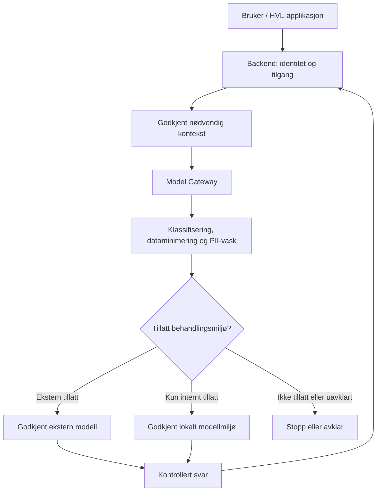

Innebygd personvern er et grunnleggende arkitekturprinsipp for HVLs KI-økosystem, ikke en funksjon som legges til i etterkant. Målbildet bygger på at HVL kontrollerer brukerrelasjonen, identiteten, konteksten og systemtilgangene. KI-modellene er utskiftbare beregningsressurser.

## Identitet og pseudonymisering

Brukeren autentiseres med FEIDE eller Entra ID. Backend håndterer identitet, autorisasjon og koblingen mellom bruker og interne pseudonyme identifikatorer. Eksterne modelltilbydere skal ikke motta navn, e-post, innloggingsidentitet, interne bruker-ID-er, sesjonstokens eller andre direkte identitetsmetadata. Modellkall skjer på vegne av plattformen, ikke gjennom brukerens personlige konto hos modelltilbyderen. Unngå også stabile eksterne brukeridentifikatorer som ikke er nødvendige for formålet.

Pseudonymisering er ikke anonymisering: data som kan knyttes tilbake til en person, er fortsatt personopplysninger. Selve prompten, vedlegg, hentede dokumentutdrag, minne og tool-resultater kan inneholde identifiserende informasjon.

## Model Gateway og PII-vaskemaskinen

Model Gateway skal være kontrollpunktet for modelltilgang. PII (personally identifiable information) betyr her informasjon som kan identifisere en person. PII-vaskemaskinen skal bidra til å oppdage og redusere slik informasjon før data eventuelt sendes til en ekstern modell.

| Kontroll | Formål |
|---|---|
| Dataminimering | Bare kontekst nødvendig for oppgaven sendes videre. |
| PII-deteksjon | Identifisere mulige personopplysninger, også i vedlegg og tool-resultater. |
| Maskering og pseudonymisering | Fjerne eller erstatte identifiserende opplysninger der formålet tillater det. |
| Modellpolicy | Tillate, rute internt eller avvise basert på klassifisering, formål og godkjent behandlingsmiljø. |
| Responskontroll | Kontrollere svaret og eventuelt gjeninnsette tillatte verdier internt under tilgangskontroll. |

En eventuell koblingstabell for reversible erstatninger skal holdes internt, tilgangsstyres, ha avgrenset levetid og aldri sendes til modellen. Vaskemaskinen må ikke endre innhold på en måte som ødelegger oppgavens faglige mening uten at dette håndteres.

Deteksjon er ikke perfekt; indirekte identifikatorer og kombinasjoner av opplysninger kan avsløre identitet. Usikker klassifisering eller manglende godkjenning må gi sikker håndtering, ikke automatisk oversendelse. Vaskemaskinen erstatter ikke dataklassifisering, behandlingsgrunnlag, risikovurdering eller avtaler.

## Hele datalivsløpet

Samtalehistorikk, brukerminne, tilgangskontroll og personlig kontekst forvaltes i HVLs godkjente miljø. Memory Fabric og HVL Knowledge skal ikke være direkte tilgjengelige for eksterne modeller. En modell kan foreslå verktøykall, men HVLs tjenester avgjør om et kall er tillatt og hvilke data som kan utleveres.

Personvernkrav gjelder også embeddings, multimodale modeller, hjelpekall, reserve- og syntesemodeller, telemetri, mellomlagring og logger. Ingen alternativ modellvei skal omgå policyen. Modelltilbydernes behandlingsvilkår, lagring, bruk til trening, underleverandører og eventuelle overføringer må vurderes før bruk. Det må etableres slettefrister, formålsavgrensning, rettighetsprosesser og evaluering av PII-deteksjon, inkludert feil og omgåelser.

## Eksempel

En ansatt ber om hjelp til å oppsummere et dokument. Backend kontrollerer dokumenttilgangen og henter bare relevante utdrag. Gateway vurderer innhold og klassifisering, maskerer unødvendige identifikatorer og ruter til en modell som er godkjent for behandlingen. Hvis data ikke kan sendes forsvarlig, skal en egnet intern modell brukes dersom det er tillatt, ellers stoppes forespørselen. Brukerens identitets- og tilgangsinformasjon forblir i HVLs kontroll.

Dette beskriver målarkitekturen, ikke verifisert implementering eller godkjenning. GDPR artikkel 25 om innebygd personvern og personvern som standardinnstilling er et relevant rammeverk; etterlevelse må dokumenteres for de konkrete behandlingene.
