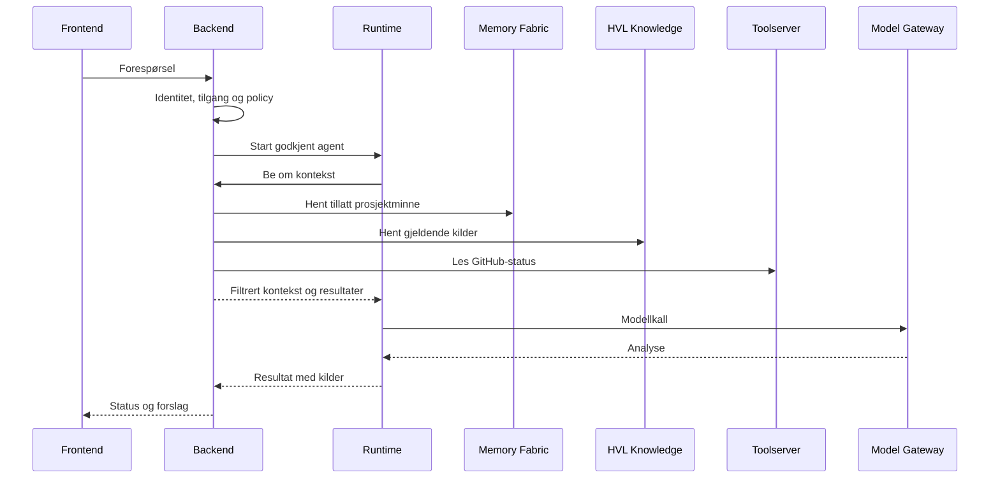

En prosjektleder ber om status fra GitHub og beslutninger fra forrige møte, med forslag til neste ukes prioriteringer.

Skills for statusrapportering styrer metode. Modellvalg skjer innenfor policy. Endringer i GitHub krever separat godkjent handling. Nye prosjektbeslutninger kan lagres i memory etter gjeldende regler.

## Praktisk oppgave

Design en Canvas-læringsassistent: angi brukergruppe, ansvar, emnekilder, modell, skills, memory-scope, tillatte tools, lærerens rammer og evalueringskriterier. Marker hva som krever godkjenning før pilot.

## Før kode

Verifiser faktiske API-kontrakter, komponentstatus, dataflyt og sikkerhetsgrenser i hovedrepoet. Kursdiagrammer er logiske og viser ikke fullstendig nettverkstopologi.
