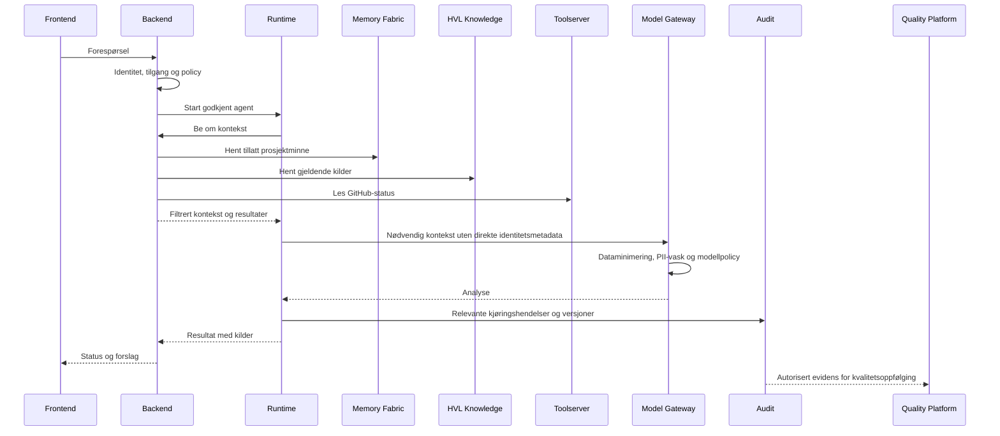

En prosjektleder ber om status fra GitHub og beslutninger fra forrige møte, med forslag til neste ukes prioriteringer.

Skills for statusrapportering styrer metode. Modellvalg skjer innenfor policy. Eksterne modeller mottar bare godkjent kontekst, ikke brukerens innloggingsidentitet eller direkte systemtilgang. Endringer i GitHub krever separat godkjent handling. Nye prosjektbeslutninger kan lagres i memory etter gjeldende regler.

Ved behov benytter agenten Execution Platform til å produsere og validere en rapportfil. Produksjonsfunn kan bli nye regresjonstester i Evals. Quality Platform koordinerer gjennomgang og publisering av forbedrede versjoner. Planlagte kjøringer kan initieres av Automation Platform med samme policy og godkjenningskrav.
