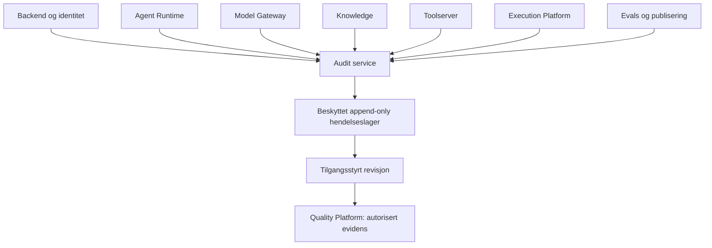

HVL bygger inn sporbarhet i hele kjeden fra brukerforespørsel til modellkall, kildeoppslag, agentkjøring og utført handling. Audit er en egen tjeneste og et separat ansvarsområde fra ordinære driftslogger, tracing og Evals. Den tekniske løsningen støtter forvaltning, hendelseshåndtering og dokumentasjon av relevante regulatoriske krav.

## Tre typer telemetri

| Type | Formål | Eksempler |
|---|---|---|
| Observability | Stabil drift og kapasitet | Metrics, feilrater, latency, tokens, kostnad og køer. |
| Distributed tracing | Forstå en kjørings forløp | TraceId/spanId, modell- og tool-kall, subagent, RAG-oppslag og execution session. |
| Audit | Etterprøvbar dokumentasjon av relevante hendelser | Autorisasjon, policybeslutning, godkjenning, versjon, handling og endring. |

OpenTelemetry er et aktuelt standardgrensesnitt for metrics og distributed tracing. LangSmith kan understøtte agenttraces og kvalitetsanalyse der behandlingsmiljø og databehandling er godkjent. Ingen av dem erstatter HVLs autoritative revisjonsspor. Tracing beskriver observerbare hendelser og modellresultater, ikke skjult intern resonnering.

## Hendelsesmodell og korrelasjon

Backend etablerer requestId og runId. Run Context formidler intern pseudonym aktørreferanse, effektive rettigheter, risikoprofil og korrelasjonsinformasjon til ansvarlige tjenester. Hver tjeneste registrerer sine egne observerte hendelser. Multiagentkjøringer har parentRunId; tracing bruker traceId og spanId, og Execution Platform bruker executionId og sessionId. Interne identitets- og korrelasjonsverdier skal ikke sendes til eksterne modeller som standard.

| Feltgruppe | Eksempel på data |
|---|---|
| Identifikasjon | eventId, eventType, timestamp, sourceService, schemaVersion, runId og requestId. |
| Aktør og scope | Pseudonym aktørreferanse, rolle eller delegert tjeneste, relevant tenant/prosjekt-scope. |
| Konfigurasjon | Agent-/graph-versjon, modell og leverandørversjon, prompt-/skill-/tool-/policy-versjon. |
| Kildegrunnlag | Tilgangsstyrte referanser til kilde, dokumentversjon og indeks der relevant. |
| Kontroll og handling | Autorisasjonsutfall, ruting, PII-kontrollutfall, godkjenningsreferanse, verktøy, mål og status. |
| Resultat | Utfallet, feilkategori, artefaktreferanse og relevante målinger. |

Dette er en logisk kontrakt, ikke krav om at hvert event inneholder alle feltene. Rå prompts, dokumenter, credentials, PII-verdier og komplette tool-resultater inngår ikke i standard audit. Når innhold er nødvendig som evidens, håndteres det separat med eksplisitt formål, tilgang og levetid. Bruk evidensreferanser og integritetskontroller der det er hensiktsmessig.

Audit-hendelser skal være beskyttet mot uautorisert endring og sletting, ha versjonert schema, pålitelig tidsgrunnlag, idempotent innsending og kontrollert oppbevaring. Append-only gjelder ordinære skrivere; godkjent livsløpshåndtering og lovpålagt sletting må fortsatt kunne gjennomføres. Audit bruker ekstern PostgreSQL for strukturerte revisjonshendelser, med beskyttede skriverettigheter og integritetskontroller. Eventuelle godkjente evidensobjekter lagres i ekstern S3-kompatibel objektlagring. Datalagrene ligger utenfor containerne. Kritiske handlinger må ha en definert strategi ved utilgjengelig audit; eksempelvis sikker stans eller pålitelig utboks med avklart risiko. Tilgang til revisjonsspor logges også.

## Krav i EU AI Act

Primærkilde: [forordning (EU) 2024/1689](https://eur-lex.europa.eu/eli/reg/2024/1689). Tabellen kobler bestemmelser til plattformens tekniske kontrollpunkter. Den konkrete anvendelsen avhenger av formål, risikoklasse, rolle og gjeldende norsk/EØS-rett.

| Bestemmelse | Arkitekturens bidrag |
|---|---|
| Art. 9 og 10 | Risikostyring, evals, datasettstyring og dokumentasjon av relevante data der kravene gjelder. |
| Art. 11 og vedlegg IV | Versjonert teknisk dokumentasjon, konfigurasjon, testresultater og endringshistorikk. |
| Art. 12 | Automatisk hendelsesregistrering for høyrisikosystemer gjennom levetiden. |
| Art. 13 og 14 | Informasjon til idriftsetter, forståelige kontrollpunkter, godkjenning, avbrudd og menneskelig overstyring. |
| Art. 15 | Robusthet, nøyaktighet, sikkerhet og relevante kvalitetstester. |
| Art. 17, 19 og 26 | Kvalitetsstyring, oppbevaring av relevante logger og oppfølging etter virksomhetens rolle. |
| Art. 72 og 73 | Produksjonsovervåking, avvik, korrigerende tiltak og grunnlag for eventuell rapportering av alvorlige hendelser. |

Artikkel 19 og 26 nr. 6 angir for høyrisikosystemer som hovedregel minst seks måneders oppbevaring av de relevante automatisk genererte loggene under henholdsvis tilbyderens eller idriftsetterens kontroll, med forbehold for annen relevant lovgivning, særlig personvern. Artikkel 12 krever ikke at alle rå prompts og svar lagres. Risikoklassifisering etter artikkel 6 og vedlegg III, rolleavklaring og øvrige plikter gjøres per tjeneste; det felles rammeverket er ikke en samsvarserklæring.

## Privacy by Design og drift

Sporbarhet følger dataminimering og formålsbegrensning. Tilganger skiller driftsoperatører, revisorer, sikkerhetsfunksjoner og faglige kvalitetsreviewere. Identitetsoppslag og eventuelle rå evidensdata krever særskilt autorisasjon. Lagring, eksport, PII-maskering, retention, sikkerhetskopier og sletting er policybasert, ikke én universell frist. Overvåking må ikke bli skjult profilering av studenter eller ansatte.

Quality Platform bruker et avgrenset utvalg autoriserte hendelser og evidens for avviksanalyse. Nye evals, forbedringsforslag og release decisions kan kobles tilbake til hendelsen. Dette gir sammenheng fra produksjonsfeil til korrigert agentversjon, uten at kvalitetstjenesten kan omskrive audit-historikken.

Se [Evals og Quality Platform](./evaluering.mdx), [Execution Platform](./kjoremiljo.mdx) og [Innebygd personvern](./personvern.mdx).
