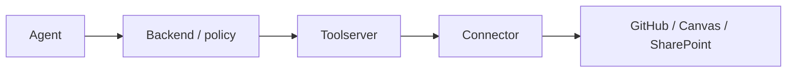

Et tool er en avgrenset funksjon, eksempelvis å hente prosjektstatus. En connector integrerer med et system og kan tilby flere tools eller kunnskapskilder.

Toolserver registrerer, validerer og utfører godkjente verktøy. MCP er en aktuell standard for å eksponere verktøy. Modellen foreslår et kall; den ansvarlige tjenesten kontrollerer identitet, input, rettigheter, policy og eventuelle godkjenninger ved kjøring. Skill mellom lesing og skriving, og gi minst mulig tilgang.

En felles connector-tjeneste kan gjenbrukes av Knowledge for søk og synkronisering og av Toolserver for handlinger, dersom tilganger og ansvarsgrenser er tydelige. Separate lesetilganger og skriveterettigheter skal ikke blandes.

## Web Service og nettsøk

Nettsøk med kildegrunnlag er obligatorisk i første MVP. SearXNG planlegges som selvdriftet metasøkemotor i Kubernetes. Web Service håndterer søk, kontrollert henting og parsing av innhold, deduplisering, metadata og kildeproveniens; avansert crawling og dynamiske sider kan komme senere. Toolserver eksponerer søk og henting for chat og API-agenter. Brukerpreferanser for søkemotor kan bare velges innenfor institusjonens policy; søkeord kan bli sendt til eksterne søkemotorer. Kontroller dataminimering, egress, SSRF (inkludert DNS, omdirigeringer og private adresser), ressursgrenser, prompt-injeksjon og leverandørvilkår. Kilder må underbygge svarenes påstander. PDF-er og andre dokumenter kan behandles via godkjent ingest.

Gravitee.io vurderes som mulig grunnlag for Toolserver, separat fra planlagt API-forvaltning for publiserte agenter. Valget er ikke ferdig avklart.
