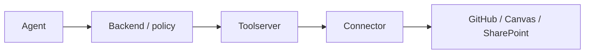

Et tool er en avgrenset funksjon, eksempelvis å hente prosjektstatus. En connector integrerer med et system og kan tilby flere tools eller kunnskapskilder.

Toolserver registrerer, validerer og utfører godkjente verktøy. MCP er en aktuell standard for å eksponere verktøy. Modellen foreslår et kall; den ansvarlige tjenesten kontrollerer identitet, input, rettigheter, policy og eventuelle godkjenninger ved kjøring. Skill mellom lesing og skriving, og gi minst mulig tilgang.

En felles connector-tjeneste kan gjenbrukes av Knowledge for søk og synkronisering og av Toolserver for handlinger, dersom tilganger og ansvarsgrenser er tydelige. Separate lesetilganger og skriveterettigheter skal ikke blandes.
